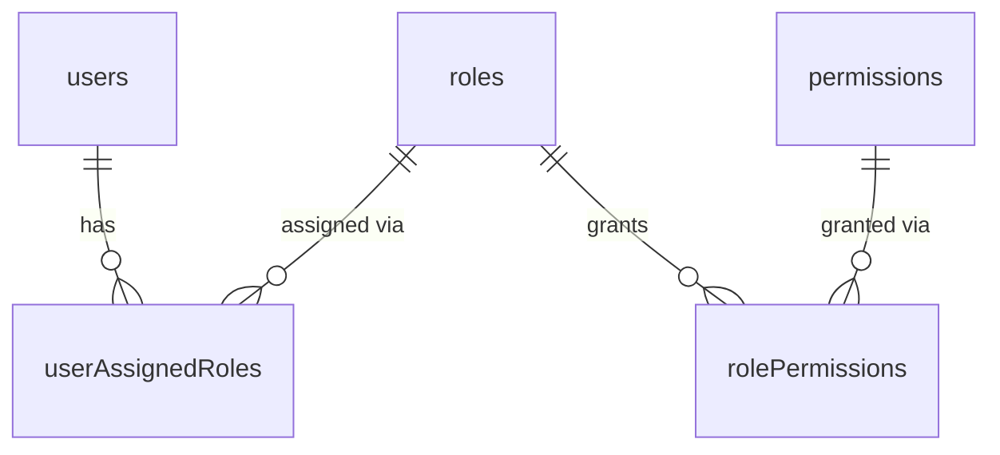
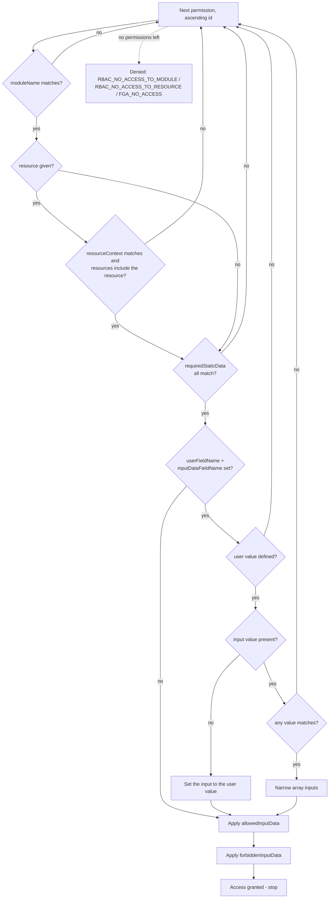

# Access Control

The permissions system is a hybrid of role-based access control (RBAC) and fine-grained access control (FGA). Permissions are assigned to roles, roles are assigned to users, and every permission can optionally carry fine-grained rules that check - and mutate - the request input and the response output.

The logic lives in the `@node-c/domain-iam` module's <a href='../../packages/domain-iam/src/services/authorization/iam.authorization.service.ts' target='_blank'>IAMAuthorizationService</a>. It's use-case-agnostic: the HTTP API modules use it automatically for every controller route, and it can also be called directly from business logic.

&nbsp;

## Data model



Tables (in the reference app, `apps/test`):
- `permissions` - the permissions themselves (see the fields below)
- `roles` - `id`, `name` (unique), `isActive`, `isEditable`
- `rolePermissions` - `roleId`, `permissionId` (many-to-many between roles and permissions)
- `userAssignedRoles` - `roleId`, `userId` (many-to-many between users and roles)

Permission fields:
- `id: number` - auto-generated. **Permissions are evaluated in ascending `id` order** (see below), so the id matters.
- `name: string` - required, unique
- `moduleName: string | null` - the API module the permission applies to (for HTTP usage)
- `resourceContext: string | null` - the controller context (for HTTP usage)
- `resources: string[] | null` - the resources (route handlers) within the context
- `requiredStaticData: Record<string, unknown> | null`
- `inputDataFieldName: string | null` - required if `userFieldName` is set
- `userFieldName: string | null` - required if `inputDataFieldName` is set
- `allowedInputData: Record<string, unknown> | null`
- `forbiddenInputData: Record<string, unknown> | null`
- `allowedOutputData: Record<string, unknown> | null`
- `forbiddenOutputData: Record<string, unknown> | null`

> Older versions used `authorizationPoints`, `userTypes`, `userTypeAuthorizationPoints`, `userTypeAssignedUsers`, `moduleNames`, `controllerNames` and `handlerNames`. These were renamed by the `PermissionsUpdates` and `PermissionsUpdate2` migrations - use the new names in any new SQL.

&nbsp;

## How the user's permissions are loaded

The users domain service's `getUserWithPermissionsData` loads the user with `assignedRoles.permissions` (and any relations the permissions need, such as `assignedCourses` in the reference app), then flattens the permissions into `user.currentPermissions`, keyed by permission id. The authorization middleware puts the user in `req.locals.user` - either from the token payload or, if `localSearchForUsersEnabledOnAuthorization` is enabled for the API module, by loading it on every request.

Any field referenced by a permission's `userFieldName` (e.g. `assignedCourses.id`) **must be loaded on that user object**, otherwise the check fails (see the FGA rules below).

&nbsp;

## HTTP usage

The `HTTPAccessControlInterceptor` (from `@node-c/api-http`) runs before every route handler of a controller that uses it (`RESTAPIEntityController` does) and calls `IAMAuthorizationService.checkAccess` with:
- `moduleName` - the value provided for `NodeCDomainIAMConstants.ACCESS_CONTROL_MODULE_NAME` in the API module (or the API module name)
- `resourceContext` - the string passed to `@AccessControlContext('...')` on the controller class (or its `context` field, if an object is passed), falling back to the class name
- `resource` - the value of `@AccessControlResource('...')` on the handler, or the `resourceMap` entry of the context object, falling back to the **handler method name** (e.g. `find`, `findOne`, `delete`)
- the input data - `{ body, headers, params, query }` of the request (**not** the whole `req` object - so input paths always start with `body.`, `headers.`, `params.` or `query.`)
- the user - `req.locals.user`

If access is denied, the interceptor throws `HttpException('Forbidden', 403)`. If access is granted, it applies the input mutations to the request (see below) before the handler runs, and the output mutations to the handler's result.

Other cases:
- `req.locals` not set (the authorization middleware didn't run) → 403.
- Anonymous routes and API key routes (`locals.isAnonymous` / `locals.isApiKeyRoute`) skip access control entirely.
- No module name configured (neither `ACCESS_CONTROL_MODULE_NAME` nor `API_MODULE_NAME`) → 500, with `No moduleName configured for <Class>.<handler>.` in the logs.

&nbsp;

## Direct usage

```typescript
const { errorCode, hasAccess, inputDataToBeMutated, permissions } = IAMAuthorizationService.checkAccess(
  inputData, // any object - the paths in the permissions are resolved against it
  user, // must have currentPermissions
  { moduleName, resourceContext, resource }
);
// apply inputDataToBeMutated to the input with setNested, if access was granted
const { outputDataToBeMutated } = IAMAuthorizationService.processOutputData(permissions, outputData);
```

`permissions` contains only the permission that granted access.

- `resource` is optional. Without it, only the module is checked (step 2 below is skipped).
- Passing a `resource` without a `resourceContext` throws an `ApplicationError`.

&nbsp;

## How a check is evaluated

`checkAccess` goes through `user.currentPermissions` **in ascending id order** and **stops at the first permission that passes**. Only that permission's mutations and output rules are applied.



For each permission:
1. **RBAC - module.** If `moduleName` doesn't match, the permission is skipped.
2. **RBAC - resource.** If a resource is being checked and the permission's `resourceContext` doesn't match or its `resources` don't include it, the permission is skipped.
3. **FGA - required static data.** Every key of `requiredStaticData` is a path into `{ inputData, user }` (e.g. `inputData.query.filters.courseTypeId`). If any value doesn't match, the permission fails and the next one is checked.
4. **FGA - user field vs input field** (when both `userFieldName` and `inputDataFieldName` are set):
   - if the user value is `undefined` (including an empty array - see the pitfalls) → the permission fails
   - if the input value is missing → it's **set** to the user value (e.g. `query.filters.id` becomes the user's assigned course ids) and the permission passes
   - if the input value is present and none of its values match the user value(s) → the permission fails
   - if the input value is an array → it's **narrowed** to the matching values (a single matching value is kept as is)
5. **Input whitelist - `allowedInputData`.** For each path, values that don't match the allowed values are removed. If none match, the field is set to `undefined`.
6. **Input blacklist - `forbiddenInputData`.** For each path, if any value matches, **the whole field** is set to `undefined` (e.g. `query.include: ['courseType', 'category']` with a forbidden `/category/` removes the whole include, not just `category`).

If no permission passes, `hasAccess` is `false` and `errorCode` is one of:
- `RBAC_NO_ACCESS_TO_MODULE` - the user has no permissions, or all of them are for other modules
- `RBAC_NO_ACCESS_TO_RESOURCE` - all of the user's permissions are for the module, but none cover the resource context/resource
- `FGA_NO_ACCESS` - anything else. Usually a permission covered the resource but its fine-grained checks failed, but this is also the code when the user's permissions are a mix of other-module and other-resource ones.

The interceptor logs the error code: `[<module>][HTTPAccessControlInterceptor]: No user access to resource <module>.<context>.<resource> - <errorCode>.` - check the app logs when debugging a 403.

### Output rules

After the handler, for the permission that granted access:
- `allowedOutputData` - values at the path that don't match are set to `undefined` (and so dropped from the JSON response)
- `forbiddenOutputData` - values at the path that match are set to `undefined`

Paths go through arrays, e.g. `result.items.deletedAt` applies to every item of a find result, and `result.courseType.createdAt` to an included relation of a findOne result.

### Value matching

Values are compared with `IAMAuthorizationService.testValue`:
- a string that starts and ends with `/` is a regular expression, tested with `RegExp.test` against the value (or its `JSON.stringify` output, for non-strings)
- objects are compared by their JSON representation
- otherwise, the value is compared as-is, as an integer and as a float (so `'2'` from a query string matches `2`), and `'true'`/`'false'` match booleans

&nbsp;

## Example

From the reference app's seeds - non-admin users can find free courses and the courses assigned to them:

```typescript
// id 1 - checked first
{
  name: 'NonAdminFindFreeCourses',
  moduleName: 'coursePlatform',
  resourceContext: 'CoursePlatformCoursesEntityController',
  resources: ['find'],
  requiredStaticData: { 'inputData.query.filters.courseTypeId': 1 },
  allowedInputData: { 'query.include': ['/^lessons(\\.lessonType)?$/', 'courseType'] },
  allowedOutputData: { 'result.items.createdAt': '/[0-9-.:TZ]/', 'result.items.deletedAt': '/[0-9-.:TZ]/' }
}
// id 3 - only reached if id 1 fails
{
  name: 'NonAdminFindNonFreeCourses',
  moduleName: 'coursePlatform',
  resourceContext: 'CoursePlatformCoursesEntityController',
  resources: ['find'],
  inputDataFieldName: 'query.filters.id',
  userFieldName: 'assignedCourses.id',
  allowedInputData: { 'query.include': ['/^lessons(\\.lessonType)?$/', 'courseType'] }
}
```

- `GET /courses?filters[courseTypeId]=1&include[]=lessons&include[]=category` → permission 1 passes, `category` is removed from the include, and `deletedAt` (which is `null` and so doesn't match the pattern) is removed from every item.
- `GET /courses` → permission 1 fails (no `courseTypeId`), permission 3 passes and sets `query.filters.id` to the user's assigned course ids.
- `GET /courses?filters[id]=3` (course 3 not assigned) → both fail → 403 `FGA_NO_ACCESS`.
