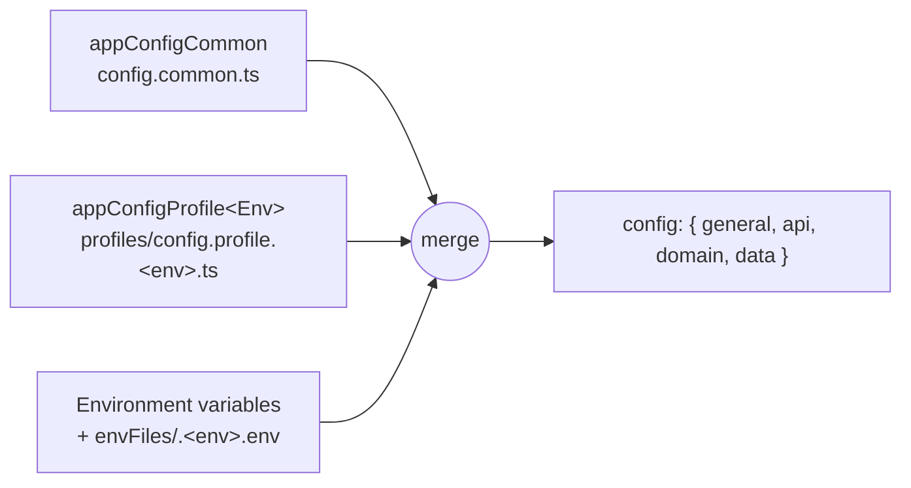

# Configuration, Startup and Logging

&nbsp;

## Where the config comes from

The app config is one object, built at startup from three sources, each overriding the previous one:



1. **Common config** (`appConfigCommon`) - everything that's the same in every environment: API module options, IAM settings, data module types.
2. **Profile** (`appConfigProfile<Env>`) - per-environment values such as hostnames, ports and URLs. The environment is `options.envName`, else `NODE_ENV`, else `local`; the profile export name is that value with its first letter capitalized (`endToEndTests` → `appConfigProfileEndToEndTests`). The values are listed in `AppEnvironment`: `development`, `local`, `production`, `staging`, `endToEndTests`.
3. **Environment variables** - secrets and connection details. With `useEnvFile: true`, `envFiles/.<env>.env` (under `general.projectRootPath`) is read as well; with `useEnvFileWithPriority: true`, the file wins over the process environment. `*.env` files are gitignored.

The config object is split by module: `config.api.<apiModule>`, `config.domain.<domainModule>`, `config.data.<dataModule>` and `config.general`. Inject `ConfigProviderService` and read `configProvider.config` to use it.

&nbsp;

## Environment variables

Each module declares its type with one variable, then gets its fields from others:

```bash
# <CATEGORY>_<MODULE>_MODULE_TYPE=<TYPE>
DATA_DB_MODULE_TYPE=RDB
# <CATEGORY>_<MODULE>_<FIELD>=value   →   config.<category>.<module>.<field>
DATA_DB_HOST=localhost                 # config.data.db.host
DATA_DB_DATABASE_NAME=node-c           # config.data.db.database
DOMAIN_IAM_MODULE_TYPE=IAM
DOMAIN_IAM_JWT_ACCESS_SECRET=...       # config.domain.iam.jwtAccessSecret
```

- **Categories** are `API`, `DOMAIN` and `DATA`.
- **Types and fields** come from `envKeys` (default `APP_CONFIG_FROM_ENV_KEYS`):
  - `API` + `HTTP`/`REST`: `API_KEY`, `API_SECRET`, `HOSTNAME`, `PORT`
  - `DOMAIN` + `IAM`: `JWT_ACCESS_SECRET`, `JWT_REFRESH_SECRET`
  - `DATA` + `RDB`: `DATABASE_NAME`, `HOST`, `PASSWORD`, `PORT`, `USER`
  - `DATA` + `NOSQL`: `HOST`, `PASSWORD`, `PORT`, `SENTINEL_PASSWORD`, `USER`
- **Module names** map to config keys through `envKeysParentNames`, e.g. `DATA` → `data`, `CACHE_AUTH` → `cacheAuth`. A module that's not in the map, or a type that's not in `envKeys`, is ignored.

Apps extend both maps. The reference app (`apps/test/src/app.module.ts`) adds its module names and extra IAM fields, e.g. `DOMAIN_IAM_USER_LOCAL_PASSWORD_SECRET` → `domain.iam.authServiceSettings.userLocal.secretKey.hashingSecret`.

Values from the environment are **strings** - code that reads ports or numbers from the config must parse them.

&nbsp;

## Starting the app

```typescript
const apps = await NodeCApp.start(
  [AppModuleCoursePlatformDelegated, AppModuleSSO],
  {
    apiModulesOptions: [
      { appModuleIndex: 0, apiModuleName: 'coursePlatformDelegated' },
      { appModuleIndex: 1, apiModuleName: 'sso' }
    ],
    generateOrmConfig: true,
    loadConfigOptions: AppModuleBase.configProviderModuleRegisterOptions
  }
);
```

`NodeCApp.start` (`packages/core/src/app.ts`):
1. Loads the config. With `generateOrmConfig`, it also writes the TypeORM datasource files for the RDB data modules (see <a href='../Data/entities.md' target='_blank'>Defining entities</a>).
2. Creates one NestJS application per app module:
   - with an API module name whose config has `hostname` and `port` → an HTTP server listening there
   - with an API module name but no listener config → an app without a listener
   - without an API module name → an application context (no HTTP), e.g. for workers
3. For HTTP apps, enables the extended query parser and makes `req.query` writable (access control mutates it), and answers malformed requests with a JSON 400 (or 431 for headers that are too large), instead of an empty response.

Each app module is a NestJS module importing:
- `ConfigProviderModule.register(options)` and `LoggerModule.register(...)` - both global
- the data modules (`DataDBModule.register()`, `DataCacheModule.register()`, ...)
- the domain modules it needs
- **one** HTTP API module (`APIXModule.register(APIXModule.moduleOptions)`)

The reference app shares the common imports in `AppModuleBase.imports` and runs four app modules in one process - one per API.

&nbsp;

## Logging

`LoggerModule.register({ pinoParams? })` sets up a global `LoggerService`, a pino logger (through `@node-c/nestjs-pino`, an ESM build of `nestjs-pino`).
- Inject `LoggerService` and use `info`, `warn`, `error`, `debug`.
- `DEFAULT_PINO_PARAMS` writes to `logs/app_logs.txt` and pretty-prints to stdout. Every request gets a UUID request id.
- The reference app writes to `logs/app_logs_<NODE_ENV>.txt` instead.
- `HTTPRequestLoggingMiddleware` logs `[<apiModule>]: <METHOD> <path>` for every request.

The framework logs the real reason for most failures that the API hides (authentication, access control, data errors), so the log is the first place to look.
