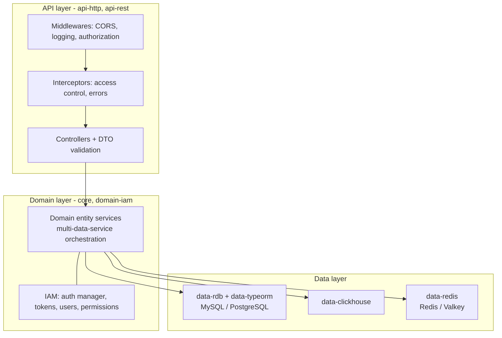
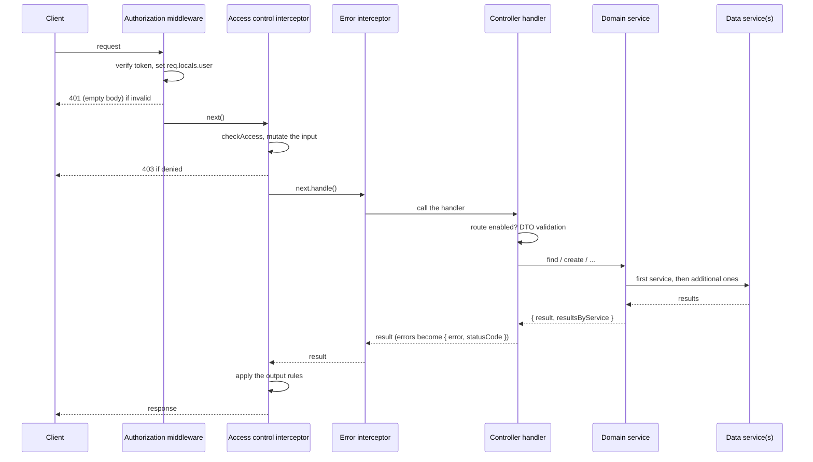
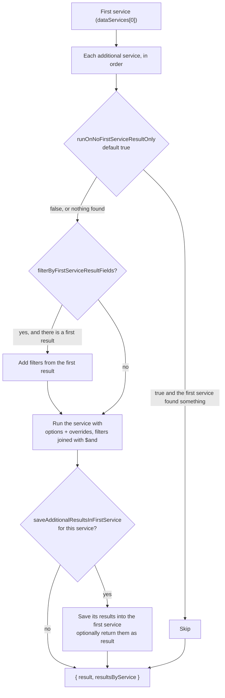

# Architecture Overview

NodeC applications are built in three layers, each a set of NestJS modules:

The reference app in `apps/test` follows the same structure: `src/api/<module>/controllers`, `src/domain/<module>/services` and `src/data/<storage>/entities`.

- How the modules are configured and started: <a href='./configuration.md' target='_blank'>Configuration, startup and logging</a>
- Each layer in detail: <a href='../API/http-module.md' target='_blank'>HTTP API module</a> and <a href='../API/rest-controllers.md' target='_blank'>REST controllers</a>, <a href='./domain-services.md' target='_blank'>Domain services</a>, <a href='../Data/entities.md' target='_blank'>Defining entities</a>

&nbsp;

## Request lifecycle

For a request to a `RESTAPIEntityController` route:

1. **Authorization middleware** (`api-http`, `http.middlewares.authorization.ts`) - verifies the bearer token (or the `sid` cookie), renews it if needed, and sets `req.locals.user` (from the token payload, or by loading the user if `localSearchForUsersEnabledOnAuthorization` is enabled for the API module). Invalid tokens get a 401.
2. **`HTTPAccessControlInterceptor`** - checks the user's permissions for the module, controller context and handler, mutates the request input if needed, and throws 403 if access is denied. See <a href='./access-control.md' target='_blank'>Access Control</a>.
3. **`HTTPErrorInterceptor`** - wraps the handler and turns errors into `{ error, statusCode }` responses (see <a href='../API/rest-controllers.md' target='_blank'>REST controllers</a>).
4. **The controller handler** - validates the body/query against the route's DTO (inside the handler, with a whitelisting validation pipe), checks that the default route is enabled, and calls the domain service. Because validation runs inside the handler, **access control sees the raw request input**, before unknown properties are stripped and values like `page=2` are transformed.
5. **The domain entity service** (`DomainEntityService` from `@node-c/core`) - runs the method on the first data service and, if more are requested, on the additional ones.
6. **The data entity service(s)** - translate the options into queries for their storage (see <a href='../Data/index.md' target='_blank'>Data</a>).
7. On the way back, the access control interceptor applies the output rules of the permission that granted access.

&nbsp;

## Multi-data-service operations

A domain entity service has a main data service and optional additional ones (e.g. `{ cache: DataCacheCoursesEntityService }`). Every domain method accepts:
- `dataServices?: string[]` - the services to use, in order. Defaults to `['main']`. The first one is the "first service"; its result is returned as `result`.
- `optionsOverridesByService?: { [serviceName]: options }` - per-service option overrides for the additional services. Override `filters` are combined with the original filters using `$and`, and the other options replace the original ones. Also supports:
  - `runOnNoFirstServiceResultOnly` - **defaults to `true`** for every method: an additional service only runs if the first one returned nothing. Set it to `false` to always run it (e.g. to write to both the database and the cache).
  - `filterByFirstServiceResultFields` - filter the additional service by fields of the first service's result, as `{ sourceField: targetField }` (e.g. `{ id: 'id' }`). It's skipped when the first service returned nothing, so it's normally combined with `runOnNoFirstServiceResultOnly: false`.
  - `returnData`, `returnOriginalItems`
- `saveAdditionalResultsInFirstService?: { serviceName, useResultsForFirstServiceReturnData?, saveOptions? }` (find/findOne) - save what an additional service found into the first one, e.g. populate the cache from the database.

The response has the shape `{ result, resultsByService? }`.

Typical use: `dataServices: ['cache', 'main']` with `saveAdditionalResultsInFirstService: { serviceName: 'main', useResultsForFirstServiceReturnData: true }` - read from the cache, fall back to the database and cache what was found.
