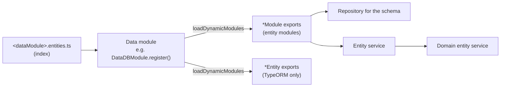

# Defining Entities

Every storage has its own way of describing an entity, but the wiring is the same: an **entity** (schema), an **entity module** that registers the repository, and an **entity service** that the domain layer uses. All three live in one folder, and the data module picks them up from its index file.

```
apps/test/src/data/<dataModule>/
  <dataModule>.module.ts           - DataXModule.register() - the storage connection
  entities/
    <dataModule>.entities.ts       - re-exports everything below (read by loadDynamicModules)
    <entity>/
      <entity>.entity.ts           - schema + TypeScript interface
      <entity>.module.ts           - registers the repository, provides/exports the service
      <entity>.service.ts          - the data entity service
  migrations/, seeds/common/       - RDB only
```



`loadDynamicModules` sorts exports by their **name suffix** - `...Module`, `...Entity`, `...Service`, `...Controller` - and skips names starting with `base` (see [Core utilities](../Fundamentals/core-utilities.md)). An entity module that isn't exported from the index file, or is named without the `Module` suffix, is never registered.

## Relational databases (TypeORM)

Entities are TypeORM `EntitySchema` objects, not decorated classes.

```typescript
// courses.entity.ts
export interface DataDBCourse extends DBEntity {
  courseType?: DataDBCourseType;
  courseTypeId: number;
  name: string;
}

export const DataDBCourseEntity = new EntitySchema<DataDBCourse>({
  columns: {
    ...DBEntitySchema.columns, // id, createdAt, updatedAt, deletedAt
    courseTypeId: { type: 'integer' },
    name: { type: 'varchar' }
  },
  relations: {
    courseType: { type: 'many-to-one', target: 'courseType', inverseSide: 'courses' }
  },
  tableName: 'courses',
  name: 'course' // relations of other entities use this as their target
});

// courses.module.ts
@Module({
  imports: [
    TypeORMDBRepositoryModule.register({
      connectionName: Constants.DATA_DB_MODULE_CONNECTION_NAME,
      entityClass: DataDBCourseEntity,
      dataModuleName: Constants.DATA_DB_MODULE_NAME
    })
  ],
  providers: [DataDBCoursesService],
  exports: [DataDBCoursesService]
})
export class DataDBCoursesModule {}

// courses.service.ts
@Injectable()
export class DataDBCoursesService extends TypeORMDBEntityService<DataDBCourse> {
  constructor(
    configProvider: ConfigProviderService,
    logger: LoggerService,
    qb: SQLQueryBuilderService,
    @Inject(Constants.RDB_ENTITY_REPOSITORY) repository: TypeORMDBRepository<DataDBCourse>
  ) {
    super(configProvider, logger, qb, repository, DataDBCourseEntity);
  }
}
```

- The shared columns are in `apps/test/src/data/dbBase/entity/base.db.entity.ts`. A column with `deleteDate: true` turns on soft deletes for the entity.
- Relation names (`courseType`, `lessons`, ...) are what `include` refers to (see [Query filters](./query-filters.md)).
- Files named `*.subscriber.*` in an entity folder are added to the generated ormconfig as subscribers.
- The data module connects with `TypeORMDBModule.register({ connectionName, folderData, moduleClass, moduleName })`. Its config is `config.data.<moduleName>`: `type` (`mysql`, `postgres` or `aurora`), `connectionName`, `failOnConnectionError` (default `true` - when `false`, a failed connection is logged and retried every minute) and `typeormExtraOptions`. The credentials come from the environment (see [Configuration](../Fundamentals/configuration.md)).

### Datasource files and migrations

TypeORM's CLI needs a datasource file per data module and environment. They're generated at the project root as `ormconfig-<module>-<env>.json` and `datasource-<module>-<env>.js`:
- on startup, when `NodeCApp.start` gets `generateOrmConfig: true` (for every RDB data module except ClickHouse, with the default paths `src/data/<module>/{entities,migrations,seeds}`), or
- manually: `DATASOURCE_ENV=<env> MODULE_NAMES=<module> npm run generate:datasource-files:local` in `apps/test`.

The datasource file loads the entities from the module's **built** index file (`dist/data/<module>/entities/<module>.entities.js`), and the migrations and `seeds/common` from `dist` too. Both files contain the database credentials in plain text - they're gitignored (`datasource*`, `ormconfig*`), so keep it that way.

```bash
cd apps/test
npm run build
DATASOURCE_ENV=local MIGRATION_NAME=src/data/db/migrations/AddCourseLevels npm run typeorm:migration:generate:db
npm run build
DATASOURCE_ENV=local npm run typeorm:migration:run:db
```

## Redis and Valkey

Redis entities are plain schema objects from `@node-c/data-redis`:

```typescript
// courses.entity.ts
const defaultSchema = getDefaultEntitySchema(EntitySchemaColumnType.Integer, 'course');

export type DataCacheCourse = RedisEntity<number> & DataDBCourse;
export const DataCacheCourseSchema: EntitySchema = {
  ...defaultSchema, // id (generated primary key), createdAt, updatedAt, deletedAt; name and storeKey = 'course'
  columns: {
    ...defaultSchema.columns,
    name: { type: EntitySchemaColumnType.String }
  }
};

// courses.module.ts
@Module({
  imports: [
    RedisRepositoryModule.register<DataCacheCourse>({
      dataModuleName: Constants.DATA_CACHE_MODULE_NAME,
      schema: DataCacheCourseSchema
    })
  ],
  providers: [DataCacheCoursesEntityService],
  exports: [DataCacheCoursesEntityService]
})
export class DataCacheCoursesEntityModule {}

// courses.service.ts
@Injectable()
export class DataCacheCoursesEntityService extends RedisEntityService<DataCacheCourse> {
  constructor(
    configProvider: ConfigProviderService,
    logger: LoggerService,
    repository: RedisRepositoryService<DataCacheCourse>,
    store: RedisStoreService
  ) {
    super(configProvider, logger, repository, store);
  }
}
```

Schema fields:
- `name` - the entity name, used in errors and for `settingsPerEntity`
- `storeKey` - the key prefix for the entity's items
- `columns.<name>`:
  - `type` - `array`, `boolean`, `integer`, `object`, `string`, `timestampTz` or `uuidv4`
  - `primary` + `primaryOrder` (required for primary keys) - primary keys make up the item's key, in `primaryOrder` order
  - `generated` - generate the value on create: an incrementing counter for `integer` (stored under `increment<delimiter><storeKey><delimiter><column>`), a UUID v4 for `uuidv4`
  - `isCreationDate`, `isUpdateDate`, `isDeletionDate` - timestamps set automatically
  - `isInnerPrimary` - identifies items inside an `isArray` entity
  - `validationProperties` - class-validator schema properties
- `isArray` - each key holds an array of items (e.g. all of a user's tokens of one type)
- `nestedObjectContainerPath` - the items are stored inside an object, at this path

The data module connects with `RedisModule.register({ folderData, moduleClass, moduleName })`. Its config is `config.data.<moduleName>` - see [Redis / Valkey](./redis.md) for the options and how keys are built.

## ClickHouse

```typescript
// userLoginLogs.entity.ts
export interface DataAuditUserLoginLog extends GenericObject {
  datetime: string;
  userId: number;
}

export const DataAuditUserLoginLogEntity: ClickHouseDBEntitySchema<DataAuditUserLoginLog> = {
  options: {
    columns: {
      datetime: { type: ClickHouseDBEntitySchemaColumnType.DateTime },
      userId: { type: ClickHouseDBEntitySchemaColumnType.BigInteger }
    },
    tableName: 'userLoginLogs',
    name: 'userLoginLog'
  }
};

// userLoginLogs.module.ts
@Module({
  imports: [
    ClickHouseDBRepositoryModule.register({
      entitySchema: DataAuditUserLoginLogEntity,
      dataModuleName: Constants.DATA_AUDIT_MODULE_NAME
    })
  ],
  providers: [DataAuditUserLoginLogsService],
  exports: [DataAuditUserLoginLogsService]
})
export class DataAuditUserLoginLogsModule {}

// userLoginLogs.service.ts - same shape as the TypeORM one
export class DataAuditUserLoginLogsService extends ClickHouseDBEntityService<DataAuditUserLoginLog> {
  constructor(
    configProvider: ConfigProviderService,
    logger: LoggerService,
    qb: SQLQueryBuilderService,
    @Inject(Constants.RDB_ENTITY_REPOSITORY) repository: ClickHouseDBRepository<DataAuditUserLoginLog>
  ) {
    super(configProvider, logger, qb, repository, DataAuditUserLoginLogEntity);
  }
}
```

- The data module connects with `ClickHouseDBModule.register({ folderData, moduleClass, moduleName })`, with `type: 'clickhouse'` in its config.
- There are no migrations for ClickHouse - create the tables yourself (the e2e global setup does it with plain SQL).
- `orderBy` fields are checked against the schema's columns, so every column you sort by must be in the schema.

## Using the entity

1. Inject the entity service into a domain entity service - as the main data service, or as an additional one (e.g. `{ cache: DataCacheCoursesEntityService }`). See [Domain services](../Overview/domain-services.md).
2. For RDB entities, add a migration and rebuild before running it.
3. Add the API controller (see [Controllers](../Overview/controllers.md)) and its permissions (see [Access Control](../Security/access-control.md)).

> [!TIP]
> The [First steps](../first-steps.md) tutorial walks through this page end to end for one SQLite entity - schema, module, service, datasource files and the first migration.

---

Previous: [Core utilities](../Fundamentals/core-utilities.md) · Next: [Query filters](./query-filters.md)
