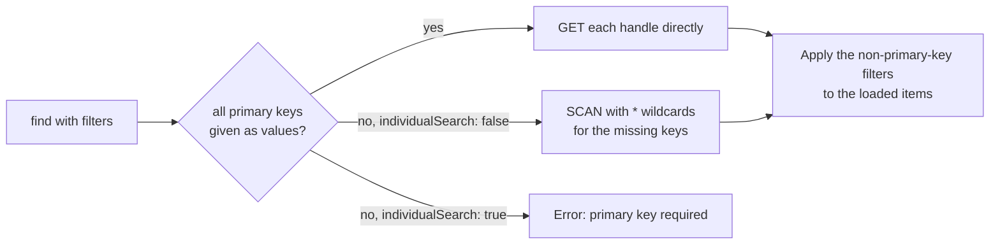

# Redis / Valkey

`@node-c/data-redis` stores entities as key-value data. The reference app uses it as a cache in front of the RDB services (the `cache` data service) and to store auth data (tokens and login step data, in `cacheAuth`). To define a Redis entity, see [Defining entities](./entities.md).

## How items are stored

An item's **handle** is built from the entity's `storeKey` and its primary key values, in `primaryOrder` order:

```
<entity storeKey><delimiter><pk0><delimiter><pk1>...      e.g. token-5-access
```

What happens with the handle depends on `useHashmap` (default `true`):

| | `useHashmap: true` (default) | `useHashmap: false` |
|---|---|---|
| Layout | One hash per data module, named after the module's `storeKey`. Each item is a field of it, keyed by its handle. | One key per item: `<module storeKey><delimiter><handle>` |
| TTL | **Not applied** - items never expire | Applied with `EXPIRE` (seconds) |

The reference app sets `useHashmap: false` for all of its Redis modules.



## Configuration

`config.data.<moduleName>`:

| Option | Meaning |
|---|---|
| `type` | `redis` or `valkey` |
| `storeKey` | The module's key prefix (or the hash name, with `useHashmap`) |
| `storeDelimiter` | Separator used in keys. Default `-` |
| `useHashmap` | See above. Default `true` |
| `defaultTTL` | Item TTL in seconds (only without `useHashmap`) |
| `defaultIndividualSearchEnabled` | Default for `individualSearch` |
| `settingsPerEntity.<entityName>` | Per-entity overrides: `ttl`, `defaultIndividualSearchEnabled`, `validationSettings` |
| `validationSettings` | `isEnabled`, `whitelistProperties`, `throwErrorOnExtraProperies` - validate items against the schema's `validationProperties` |
| `clusterMode` | Connect to a Redis cluster |
| `sentinelMode`, `sentinelMasterName`, `sentinelRole`, `usePasswordForSentinelPassword` | Connect through Sentinel |
| `failOnConnectionError` | Fail startup when the connection fails |

The host, port, user, password and sentinel password come from the environment (see [Configuration](../Fundamentals/configuration.md)).

## Behaviour

- **Primary keys required.** `update` and `delete` require the primary key filters by default (`requirePrimaryKeys: true`). Without them, the call fails with `The primary key field <name> is required when requirePrimaryKeys is set to true.`
- **`individualSearch`** (defaults to the repository's setting) - when enabled, every item is read directly by its handle, built from the primary key filters (an array of primary key values gives one handle per value), and all primary keys are required. When disabled, missing or array primary keys become `*` wildcards and the store is scanned with a cursor.
- `find` needs either `filters` or `findAll: true`. Non-primary-key filters are applied to the loaded items.
- **Generated primary keys** - `integer` keys use a counter stored at `increment<delimiter><storeKey><delimiter><column>`; `uuidv4` keys get a new UUID (with `-` replaced by `_` when the delimiter is `-`). `isArray` entities need their primary keys provided.
- Transactions use a `transactionId` (Redis `MULTI`), not a transaction manager.
- Typically used through multi-data-service options - e.g. `dataServices: ['cache', 'main']` with `saveAdditionalResultsInFirstService` - see [Multiple data services](../Fundamentals/multiple-data-services.md).

> [!WARNING]
> With the default `useHashmap: true`, nothing expires - set `useHashmap: false` for anything that relies on a TTL, such as tokens and caches.

> [!TIP]
> Cached data isn't invalidated by changes made directly in the database (seeds, SQL). Flush Redis/Valkey, or wait for the TTL.

---

Previous: [Relational databases](./rdb.md) · Next: [ClickHouse](./clickhouse.md)
