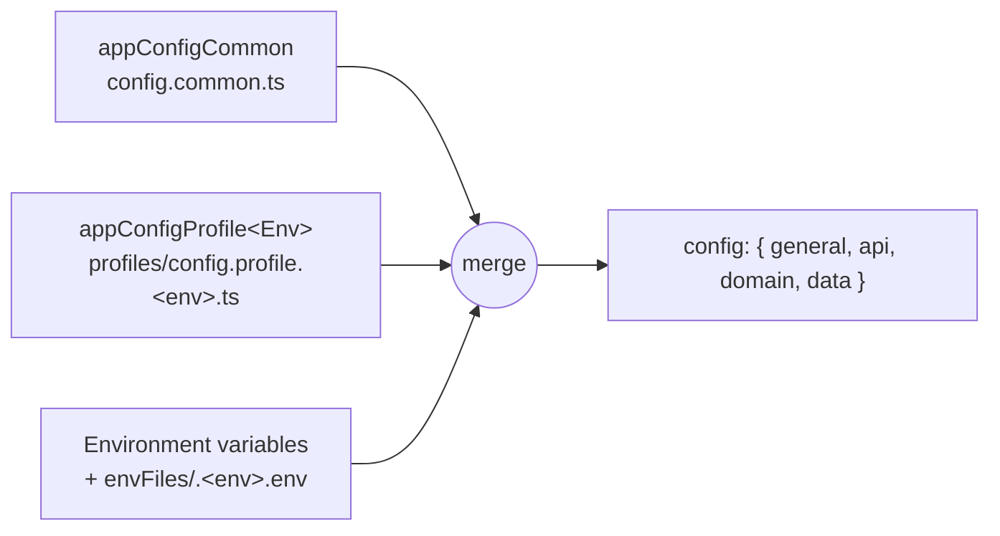

# Configuration and Startup

Every NodeC module reads its settings from one config object, so a data module, a domain module and an API module are configured the same way - and secrets never have to live in code. The object is built at startup from TypeScript files and environment variables, and `NodeCApp.start` then turns your app modules into running NestJS applications.

The whole config of the [First steps](../first-steps.md) app:

```typescript
// src/config/config.common.ts - the same in every environment
export const appConfigCommon: AppConfigCommon = {
  api: {
    tasks: { anonymousAccessRoutes: { '/tasks': [HttpMethod.GET, HttpMethod.POST /* ... */] } }
  },
  data: {
    db: { connectionName: 'db_connection', database: 'first-steps.sqlite', type: RDBType.SQLite }
  },
  domain: {},
  general: {
    projectName: 'node-c-first-steps',
    projectRootPath: path.resolve(import.meta.dirname, '../../'),
    projectVersion: '1.0.0'
  }
};

// src/config/profiles/config.profile.local.ts - only for NODE_ENV=local (the default)
export const appConfigProfileLocal: AppConfigProfile = {
  api: { tasks: { allowedOrigins: ['localhost'], hostname: '0.0.0.0', port: 3000 } },
  general: { environment: AppEnvironment.Local }
};
```

The keys under `api`, `data` and `domain` are module names - `config.data.db` belongs to the data module registered with `moduleName: 'db'`. Inject `ConfigProviderService` and read `configProvider.config` to use the config in your own code.

## Where the config comes from



Each source overrides the previous one:

1. **Common config** (`appConfigCommon`) - everything that's the same in every environment: API module options, IAM settings, data module types.
2. **Profile** (`appConfigProfile<Env>`) - per-environment values such as hostnames, ports and URLs. The environment is `options.envName`, else `NODE_ENV`, else `local`. The profile export name is that value with its first letter capitalized (`endToEndTests` → `appConfigProfileEndToEndTests`). The possible values are listed in `AppEnvironment`: `development`, `local`, `production`, `staging`, `endToEndTests`.
3. **Environment variables** - secrets and connection details. With `useEnvFile: true`, `envFiles/.<env>.env` (under `general.projectRootPath`) is read as well. With `useEnvFileWithPriority: true`, the file wins over the process environment.

The config files are passed to `ConfigProviderModule.register({ appConfigs, ... })` as one object - typically `import * as AppConfigs from './config/config.js'`, an index file that re-exports the common config and every profile.

> [!WARNING]
> Keep secrets out of `config.common.ts` and the profiles - they belong in the environment or the env files (`*.env` files are gitignored).

## Environment variables

Each module declares its type with one variable, then gets its fields from others:

```bash
# <CATEGORY>_<MODULE>_MODULE_TYPE=<TYPE>
DATA_DB_MODULE_TYPE=RDB
# <CATEGORY>_<MODULE>_<FIELD>=value   →   config.<category>.<module>.<field>
DATA_DB_HOST=localhost                 # config.data.db.host
DATA_DB_DATABASE_NAME=node-c           # config.data.db.database
DOMAIN_IAM_MODULE_TYPE=IAM
DOMAIN_IAM_JWT_ACCESS_SECRET=...       # config.domain.iam.jwtAccessSecret
```

- **Categories** are `API`, `DOMAIN` and `DATA`.
- **Types and fields** come from `envKeys` (default `APP_CONFIG_FROM_ENV_KEYS`):
  - `API` + `HTTP`/`REST`: `API_KEY`, `API_SECRET`, `HOSTNAME`, `PORT`
  - `DOMAIN` + `IAM`: `JWT_ACCESS_SECRET`, `JWT_REFRESH_SECRET`
  - `DATA` + `RDB`: `DATABASE_NAME`, `HOST`, `PASSWORD`, `PORT`, `USER`
  - `DATA` + `NOSQL`: `HOST`, `PASSWORD`, `PORT`, `SENTINEL_PASSWORD`, `USER`
- **Module names** map to config keys through `envKeysParentNames`, e.g. `DATA` → `data`, `CACHE_AUTH` → `cacheAuth`. A module that's not in the map, or a type that's not in `envKeys`, is ignored.

Apps extend both maps in the options they pass to `ConfigProviderModule.register`. The reference app (`apps/test/src/app.module.ts`) adds its module names and extra IAM fields, e.g. `DOMAIN_IAM_USER_LOCAL_PASSWORD_SECRET` → `domain.iam.authServiceSettings.userLocal.secretKey.hashingSecret`.

> [!WARNING]
> Values from the environment are **strings** - parse ports and other numbers before using them.

> [!TIP]
> A config value that's `undefined` at runtime usually means a missing `<CATEGORY>_<MODULE>_MODULE_TYPE` variable, or a module name that's missing from `envKeysParentNames`.

## Starting the app

```typescript
// src/main.ts
await NodeCApp.start([AppModule], {
  apiModulesOptions: [{ appModuleIndex: 0, apiModuleName: 'tasks' }],
  generateOrmConfig: true,
  loadConfigOptions: AppModuleBase.configProviderModuleRegisterOptions
});
```

`NodeCApp.start` (`packages/core/src/app.ts`):
1. Loads the config. With `generateOrmConfig`, it also writes the TypeORM datasource files for the RDB data modules (see [Defining entities](../Data/entities.md#datasource-files-and-migrations)).
2. Creates one NestJS application per app module:
   - with an API module name whose config has `hostname` and `port` → an HTTP server listening there
   - with an API module name but no listener config → an app without a listener
   - without an API module name → an application context (no HTTP), e.g. for workers
3. For HTTP apps, enables the extended query parser and makes `req.query` writable (access control mutates it), and answers malformed requests with a JSON 400 (or 431 for headers that are too large) instead of an empty response.

Each app module is a NestJS module importing:
- `ConfigProviderModule.register(options)` and `LoggerModule.register(...)` - both global
- the data modules (`DataDBModule.register()`, `DataCacheModule.register()`, ...)
- the domain modules it needs
- **one** HTTP API module (`APIXModule.register(APIXModule.moduleOptions)`)

The reference app shares the common imports in `AppModuleBase.imports` and runs four app modules in one process - one per API.

> [!TIP]
> Keep the `ConfigProviderModule` options in a static `configProviderModuleRegisterOptions` property of a class named `AppModuleBase`, exported from `src/app.module.ts`. The `generateDatasourceFiles` script imports `dist/app.module.js` and reads them from there.

---

Previous: [Request lifecycle](../Overview/request-lifecycle.md) · Next: [Logging](./logging.md)
