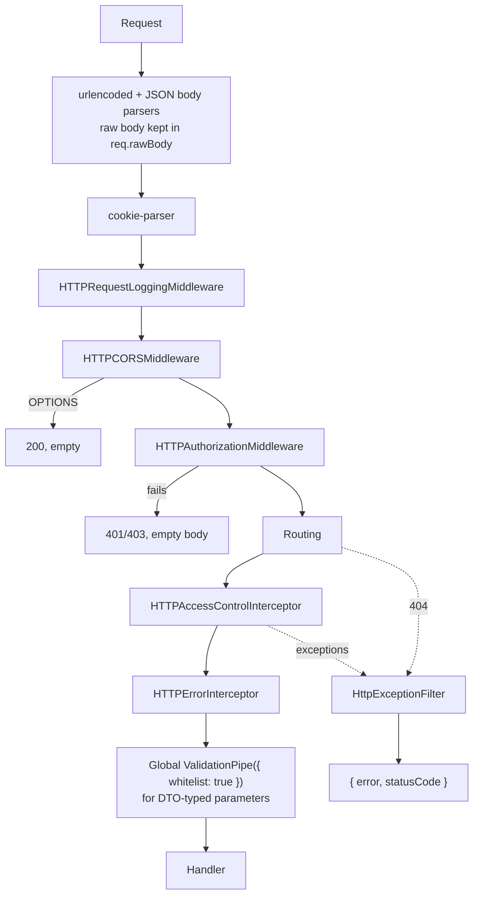

# HTTP API Module

`HTTPAPIModule` (from `@node-c/api-http`) is the base of every HTTP API module. It registers the controllers, and sets up the request pipeline around them - body parsing, CORS, request logging, authorization, access control, validation and error handling - so every API you build behaves the same way.

## Defining an API module

An API with only public routes needs nothing but its controllers:

```typescript
@Module({})
export class APITasksModule extends HTTPAPIModule {
  static readonly moduleOptions: HTTPAPIModuleOptions = {
    folderData: FolderData, // import * as FolderData from './controllers/tasks.controllers.js'
    moduleClass: APITasksModule,
    moduleName: 'tasks' // config.api.tasks
  };
}

// in the app module's imports:
APITasksModule.register(APITasksModule.moduleOptions)
```

Its routes must be listed in `config.api.tasks.anonymousAccessRoutes` - any other request gets a 401, because there's nothing to authenticate it with.

An API with logins and permissions also provides the IAM services:

```typescript
@Module({})
export class APICoursePlatformDelegatedModule extends HTTPAPIModule {
  static readonly moduleOptions: HTTPAPIModuleOptions = {
    folderData: FolderData, // the controllers index file
    moduleClass: APICoursePlatformDelegatedModule,
    moduleName: 'coursePlatformDelegated', // config.api.<moduleName>
    providers: [
      { provide: NodeCDomainIAMConstants.ACCESS_CONTROL_MODULE_NAME, useValue: 'coursePlatform' },
      { provide: NodeCAPIHTTPConstants.API_MODULE_AUTHORIZATION_SERVICE, useExisting: DomainIAMAuthorizationService },
      { provide: NodeCAPIHTTPConstants.AUTHORIZATION_MIDDLEWARE_AUTHENTICATION_MANAGER_SERVICE, useExisting: DomainIAMAuthenticationManagerService },
      { provide: NodeCAPIHTTPConstants.AUTHORIZATION_MIDDLEWARE_TOKEN_MANAGER_SERVICE, useExisting: DomainIAMTokenManagerService }
    ]
  };
}

// in the app module's imports:
APICoursePlatformDelegatedModule.register(APICoursePlatformDelegatedModule.moduleOptions)
```

Options: `folderData`, `moduleClass`, `moduleName`, `providers`, `controllers` (in addition to the ones in `folderData`), `exports`, `imports: { atStart, atEnd }`.

- `ACCESS_CONTROL_MODULE_NAME` is the `moduleName` that permissions must use. Several API modules can share one (the reference app's three course platform APIs all use `coursePlatform`). Provide it in every API module with non-public routes: the interceptor falls back to the API module name only when the provider's value is empty, and a missing provider fails the lookup.
- All three IAM providers are optional:
  - without the authorization service, only `anonymousAccessRoutes` work - every other request gets a 401
  - without the token manager, bearer tokens can't be verified - only anonymous and API-key routes work
  - without the authentication manager, the middleware still verifies tokens, but doesn't require a `userId` and doesn't load users

## The request pipeline



| Piece | What it does |
|---|---|
| Body parsers | `express.urlencoded` and `express.json` for all routes. The raw body string is kept in `req.rawBody` (for signature checks and webhooks). NestJS's own body parser is disabled. |
| `HTTPRequestLoggingMiddleware` | Logs `[<moduleName>]: <METHOD> <path>` |
| `HTTPCORSMiddleware` | CORS headers for the origins in `allowedOrigins`, and 200 for `OPTIONS` - see [API keys and CORS](../Security/api-keys-and-cors.md#cors) |
| `HTTPAuthorizationMiddleware` | Anonymous routes, API keys and bearer tokens - see [Authentication](../Security/authentication.md) |
| `HTTPAccessControlInterceptor` | Permissions - see [Access Control](../Security/access-control.md) |
| `HTTPErrorInterceptor` | Errors thrown by the handler → `{ error, statusCode }` |
| Global `ValidationPipe` | Validates and whitelists parameters typed with DTO classes |
| `HttpExceptionFilter` (global) | Everything else that's thrown (access control 403s, Nest's 404s, errors in other interceptors or pipes) → `{ error: message, statusCode }` |

The interceptors are applied by `RESTAPIEntityController` with `@UseInterceptors(HTTPAccessControlInterceptor, HTTPErrorInterceptor)`. A controller that doesn't extend it must add them itself.

## Config

`config.api.<moduleName>`: `hostname`, `port`, `allowedOrigins`, `anonymousAccessRoutes`, `allowedApiKeyRoutes`, `apiKey`, `apiSecret`, `apiSecretAlgorithm`, `localSearchForUsersEnabledOnAuthorization`. See [Configuration](../Fundamentals/configuration.md) for where the values come from.

## File uploads

`@node-c/api-rest` exports an `UploadFileDto` (`contentType` - a valid MIME type - and `name`) for routes that accept file metadata, e.g. to create a signed upload URL. There's no built-in upload route or multipart handling.

> [!WARNING]
> Every middleware runs for every route, **before routing** - so a request to a route that doesn't exist gets the authorization middleware's empty 401 (unless it has a valid token), not a 404.

---

Previous: [Multiple data services](./multiple-data-services.md) · Next: [Core utilities](./core-utilities.md)
