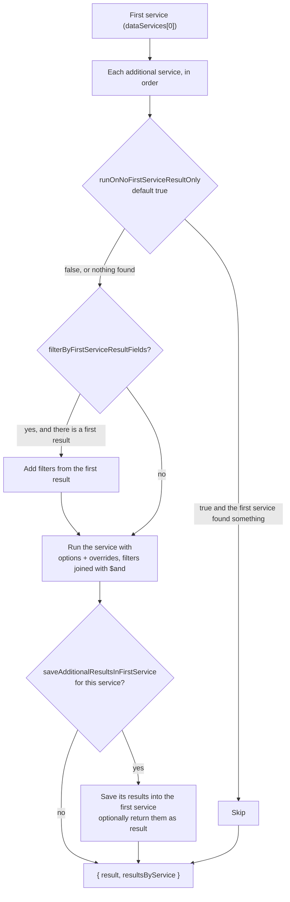

# Multiple Data Services

A domain service can work with several data services for the same entity - typically a database and a Redis cache in front of it. Instead of writing the "read from the cache, fall back to the database, then cache the result" logic yourself, you describe it with three options on any domain method call.

```typescript
// read from the cache first; if it's not there, read from the database and save it in the cache
const { result } = await coursesService.findOne({
  filters: { id: 5 },
  dataServices: ['cache', 'main'],
  saveAdditionalResultsInFirstService: { serviceName: 'main', useResultsForFirstServiceReturnData: true }
});
```

The data services a domain service can use are the ones passed to its constructor (see [Domain services](../Overview/domain-services.md)): `main` is the first constructor argument, and the others are named in the last one, e.g. `{ cache: DataCacheCoursesEntityService }`.

## The options

- `dataServices?: string[]` - the services to use, in order. Defaults to `['main']`. The first one is the **first service**, and its result is returned as `result`.
- `optionsOverridesByService?: { [serviceName]: options }` - options for the additional services. Override `filters` are combined with the original ones using `$and`, and the other options replace the original ones. Also supports:
  - `runOnNoFirstServiceResultOnly` - **defaults to `true`**: an additional service only runs if the first one returned nothing. Set it to `false` to always run it.
  - `filterByFirstServiceResultFields` - filter the additional service by fields of the first service's result, as `{ sourceField: targetField }` (e.g. `{ id: 'id' }`). It's skipped when the first service returned nothing, so it's normally combined with `runOnNoFirstServiceResultOnly: false`.
  - `returnData`, `returnOriginalItems`
- `saveAdditionalResultsInFirstService?: { serviceName, useResultsForFirstServiceReturnData?, saveOptions? }` (find and findOne only) - save what the named additional service found into the first service. With `useResultsForFirstServiceReturnData`, those results are returned as `result` when the first service found nothing.

The response is `{ result, resultsByService? }` - `resultsByService` has each additional service's result, by name.



## How each method uses the additional services

| Method | Additional services get | They run by default when |
|---|---|---|
| `find`, `findOne` | the same options, plus their overrides | the first service found nothing |
| `create`, `bulkCreate` | the **first service's result** as the data (e.g. with the database-generated id) | never - a successful create is a result, so pass `runOnNoFirstServiceResultOnly: false` |
| `update`, `delete` | the same data and options | the first service changed something (`count > 0`) |

> [!WARNING]
> `create` with `dataServices: ['main', 'cache']` does **not** write to the cache unless you also pass `optionsOverridesByService: { cache: { runOnNoFirstServiceResultOnly: false } }`.

> [!TIP]
> Additional services get a deep copy of the options, so changes the first service makes to them don't leak into the others.

All three options can also come from the REST API's request body or query string (see [Controllers](../Overview/controllers.md)). For a complete example with a Redis cache, see the [Caching recipe](../Recipes/caching.md).

---

Previous: [Logging](./logging.md) · Next: [HTTP API module](./http-module.md)
