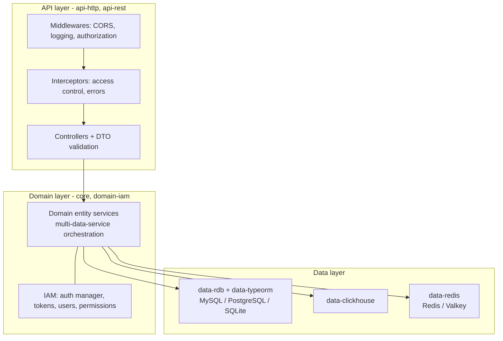

# Layers and Modules

A NodeC application is split into three layers, and every piece of code belongs to exactly one of them. Each layer is a set of NestJS modules, and each layer only talks to the one below it. This keeps HTTP concerns out of your business logic, and storage concerns out of both.



| Layer | Contains | Talks to |
|---|---|---|
| **Data** | Entities and data entity services - one service per entity and storage | the storage |
| **Domain** | Domain entity services - your business logic, one service per entity and domain | data services, other domain services |
| **API** | Controllers, plus the request pipeline (authorization, access control, validation, errors) | domain services only - never the data layer |

## One entity through all three layers

From the [First steps](../first-steps.md) app:

```typescript
// Data - a TypeORM entity and its data service
export const DataDBTaskEntity = new EntitySchema<DataDBTask>({
  columns: { ...DBEntitySchema.columns, done: { type: 'boolean', default: false }, title: { type: 'varchar' } },
  name: 'task',
  tableName: 'tasks'
});
export class DataDBTasksService extends TypeORMDBEntityService<DataDBTask> { /* constructor only */ }

// Domain - business logic on top of one or more data services
export class DomainTasksService extends DomainEntityService<DataDBTask, DataDBTasksService> { /* constructor only */ }

// API - REST routes for the domain service
@Controller('tasks')
export class APITasksEntityController extends RESTAPIEntityController<DataDBTask, DomainTasksService> { /* constructor only */ }
```

These three classes give you `POST /tasks`, `POST /tasks/bulk`, `GET /tasks` (with filters, pagination, ordering and relations), `GET /tasks/item/:id`, `PATCH /tasks` and `DELETE /tasks` (soft deletes by default).

## Module types

| Module | Base class | Registers | Example |
|---|---|---|---|
| Data module | `TypeORMDBModule`, `RedisModule`, `ClickHouseDBModule` | the storage connection and every entity module exported from its index file | `apps/first-steps/src/data/db/db.module.ts` |
| Entity module | a plain NestJS module | the repository for one entity, and its data service | `.../entities/tasks/tasks.module.ts` |
| Domain module | a plain, global NestJS module | every service exported from its services index file | `apps/first-steps/src/domain/tasks/tasks.module.ts` |
| API module | `HTTPAPIModule` | every controller exported from its controllers index file, plus the request pipeline | `apps/first-steps/src/api/tasks/tasks.module.ts` |
| App module | a plain NestJS module | the config and logger modules, the data and domain modules, and **one** API module | `apps/first-steps/src/app.module.ts` |

Each app module becomes one NestJS application when you call `NodeCApp.start`. One process can run several, e.g. a public API and an admin API sharing the same domain and data modules (see [Configuration](../Fundamentals/configuration.md)).

## Folder layout

```
src/
  main.ts                   NodeCApp.start(...)
  app.module.ts
  config/                   config.common.ts + profiles/
  data/<dataModule>/        <dataModule>.module.ts, entities/<entity>/, migrations/
  domain/<domainModule>/    <domainModule>.module.ts, services/<entity>/
  api/<apiModule>/          <apiModule>.module.ts, controllers/<entity>/
```

> [!TIP]
> Every `entities/`, `services/` and `controllers/` folder has an index file (`db.entities.ts`, `tasks.services.ts`, `tasks.controllers.ts`) that re-exports everything in it. The modules register whatever that file exports, by **export name suffix** (`...Entity`, `...Module`, `...Service`, `...Controller`) - see [Core utilities](../Fundamentals/core-utilities.md).

> [!WARNING]
> A class that isn't exported from its folder's index file, or whose name doesn't end with the right suffix, is silently ignored - Nest then fails to inject it, or the route doesn't exist.

---

Previous: [First steps](../first-steps.md) · Next: [Controllers](./controllers.md)
