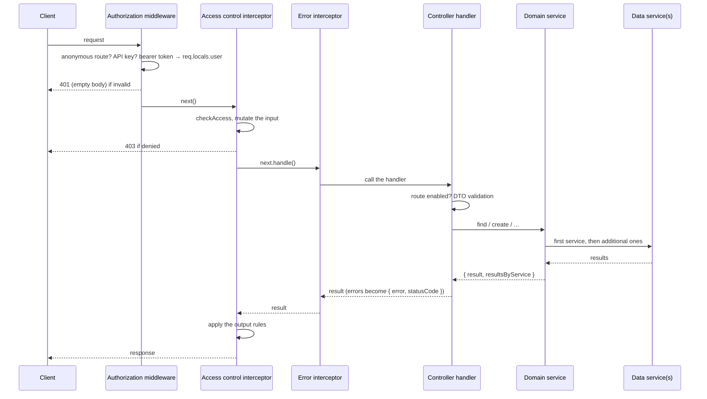

# Request Lifecycle

Every request to a NodeC API goes through the same fixed pipeline - authentication, access control, validation and error handling - before your domain code runs. Knowing the order tells you where a request was rejected, and what your code can rely on when it runs.

1. **Authorization middleware** (`HTTPAuthorizationMiddleware`) - lets anonymous routes through, checks API keys, or verifies the bearer token (or the `sid` cookie), renews it if needed and sets `req.locals.user`. A failure ends the request with an empty 401. See [Authentication](../Security/authentication.md).
2. **Access control interceptor** (`HTTPAccessControlInterceptor`) - checks the user's permissions for the module, controller and handler, mutates the request input if a permission says so, and throws a 403 if access is denied. Skipped for anonymous and API-key routes. See [Access Control](../Security/access-control.md).
3. **Error interceptor** (`HTTPErrorInterceptor`) - wraps the handler and turns any error it throws into a `{ error, statusCode }` response.
4. **Controller handler** - checks that the route is enabled, validates the body or query string against the route's DTO, and calls the domain service.
5. **Domain service** - runs the method on its first data service and, if requested, on additional ones (see [Multiple data services](../Fundamentals/multiple-data-services.md)).
6. **Data service(s)** - turn the options into queries for their storage (see [Query filters](../Data/query-filters.md)).
7. **On the way back**, the access control interceptor applies the output rules of the permission that granted access - e.g. removing fields the user may not see.

> [!WARNING]
> Validation runs *inside* the handler, so access control sees the **raw** request input: query string values are still strings, and unknown properties haven't been stripped yet.

The full list of middlewares, pipes and filters - including body parsing, CORS and request logging - is in [HTTP API module](../Fundamentals/http-module.md).

## What each failure looks like

| Response | Rejected by |
|---|---|
| 401, empty body | the authorization middleware - missing or expired token, or a route that isn't public (this includes routes that don't exist) |
| 403 `{ error: 'Forbidden', statusCode: 403 }` | access control - the log says which check failed |
| 404 `{ error: 'Not found', statusCode: 404 }` | the controller - the default route isn't enabled |
| 400 `{ error, statusCode }` | validation, or an `ApplicationError` from domain or data code |
| 500 `{ error, statusCode }` | an unexpected error - check the logs |

---

Previous: [Domain services](./domain-services.md) · Next: [Configuration](../Fundamentals/configuration.md)
