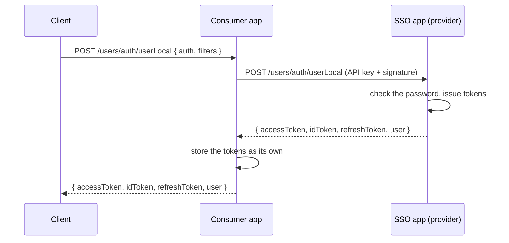

# Federated Login

Run one SSO app that owns the users and their passwords, and let your other NodeC apps log users in through it. The other apps never see a password or need the users table - they get the SSO app's tokens and user data. In the reference app, the SSO API (`apps/test/src/api/sso`, port 2080) is the provider, and the federated course platform (`apps/test/src/domain/coursePlatformFederated`, port 2060) is a consumer. For how it works, see [Authentication](../Security/authentication.md#federated-login-consumer-and-provider).



## 1. The provider (SSO app)

A normal NodeC app with local login (see [Authentication](../Security/authentication.md#logging-in)) and the login routes open:

```typescript
// config.common.ts - api.sso
anonymousAccessRoutes: { '/users/auth/userLocal': [HttpMethod.PATCH, HttpMethod.POST] }
```

## 2. The consumer's auth service

```typescript
@Injectable()
export class DomainAuthenticationUserLocalConsumerService extends IAMAuthenticationUserLocalConsumerService<UserFields, UserFields> {
  constructor(configProvider: ConfigProviderService, logger: LoggerService, @Inject(CoreConstants.DOMAIN_MODULE_NAME) moduleName: string) {
    super(configProvider, logger, moduleName, 'userLocal');
  }
}
```

Pass it to the consumer's authentication manager under `userLocal`, like any other auth service.

## 3. The consumer's config

```typescript
// config.common.ts - domain.<consumer>.authServiceSettings
userLocal: {
  nodeC: {
    apiSecretHashingAlgorithm: 'sha256',
    completeEndpoint: '/users/auth/userLocal',
    completeEndpointMethod: HttpMethod.PATCH,
    initiateEndpoint: '/users/auth/userLocal',
    initiateEndpointMethod: HttpMethod.POST,
    refreshExternalAccessTokenEndpoint: '/users/auth/userLocal',
    refreshExternalAccessTokenEndpointMethod: HttpMethod.PUT
  }
}

// config.profile.<env>.ts
userLocal: { nodeC: { baseUrl: 'http://localhost:2080' } }
```

```bash
# env file - mapped to authServiceSettings.userLocal.nodeC.apiKey / apiSecret through envKeys
DOMAIN_COURSE_PLATFORM_FEDERATED_USER_LOCAL_CONSUMER_API_KEY=...
DOMAIN_COURSE_PLATFORM_FEDERATED_USER_LOCAL_CONSUMER_API_SECRET=...
```

Open the consumer's own login routes in its `anonymousAccessRoutes`, the same way as on the provider.

> [!WARNING]
> The consumer uses the provider's tokens **as its own** and verifies them with its own `jwtAccessSecret` and `jwtRefreshSecret`, so these must be the same as the provider's.

> [!TIP]
> The same pattern works for Okta, with `IAMAuthenticationOAuth2ConsumerService` and `nodeC` settings pointing at the provider's `/users/auth/okta` routes: the provider talks to Okta, and the consumers only talk to the provider.

---

Previous: [Logging in with Okta](./okta-login.md) · Next: [End-to-end tests](../Testing/e2e.md)
