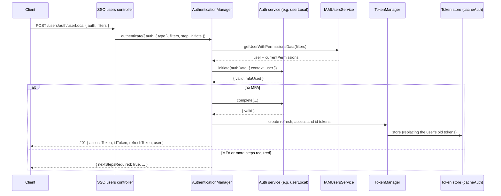
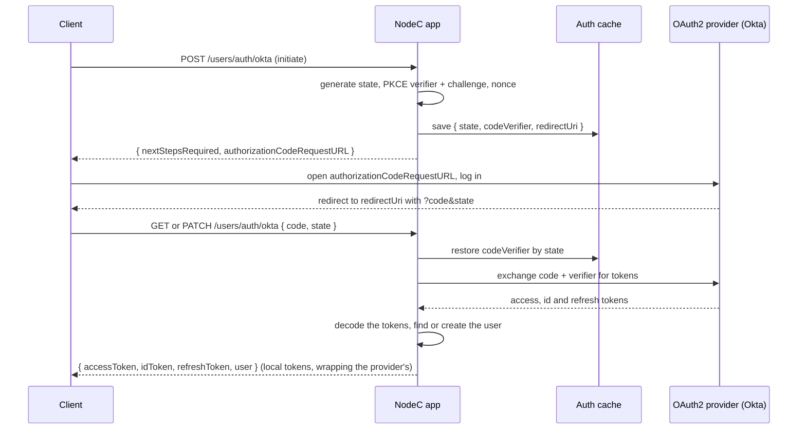
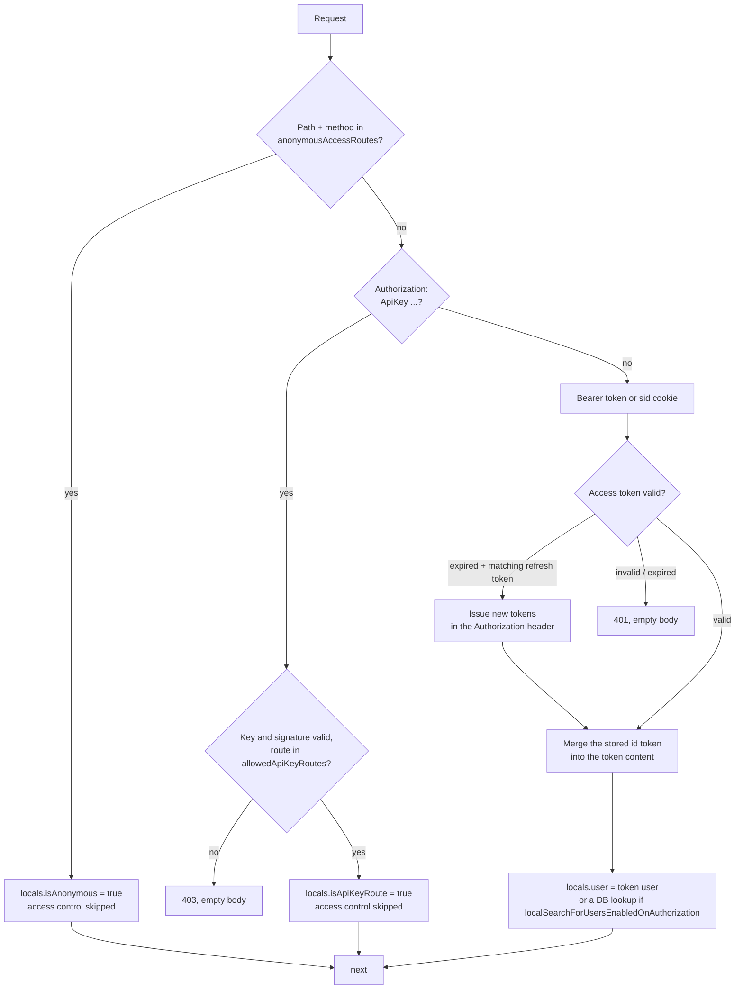

# Authentication

Authentication answers "who is making this request?". NodeC ships the whole flow: logging in with a password, an OAuth2 provider such as Okta, or another NodeC app; issuing and renewing JWTs; and checking the token on every request. Apps whose routes are all public don't need any of it (see [HTTP API module](../Fundamentals/http-module.md#defining-an-api-module)).

Authentication lives in `@node-c/domain-iam` (logging in, issuing and verifying tokens) and `@node-c/api-http` (the authorization middleware that runs on every request). Authorization - what a logged-in user may do - is covered in [Access Control](./access-control.md).

## Building blocks

| Service | Package | Role |
|---|---|---|
| `IAMAuthenticationManagerService` | domain-iam | Runs a login: picks the auth service by type (user & password, oauth2, etc.), runs its steps, finds the user and issues the tokens. |
| `IAMAuthenticationUserLocalService` | domain-iam | Email + password login. Supports pluggin in an MFA service. |
| `IAMMFAService` | domain-iam | Base class for MFA services |
| `IAMAuthenticationOAuth2Service` | domain-iam | OAuth2 login with an external provider |
| `IAMAuthenticationOktaService` | domain-iam-okta | OAuth2 OIDC flow with Okta |
| `IAMAuthenticationPassthroughService` | domain-iam | Lets another app log users in through this one, as a provider. The app implementing this service simply generates session tokens. |
| `IAMAuthentication*Consumer` services | domain-iam | These services are used by your application to log through another NodeC app's corresponding authentication services (i.e. user & password). |
| `IAMTokenManagerService` | domain-iam | Signs, stores, verifies and renews the JWTs |
| `IAMUsersService` | domain-iam | Users domain entity service, with an added `getUserWithPermissionsData` method. |
| `IAMAuthorizationService` | domain-iam | Performs token verification (`authorizeBearer`, `authorizeApiKey`) and static input & output data checking (via the static `checkAccess` method). |
| `HTTPAuthorizationMiddleware` | api-http | Wrapper for the authorization service in the HTTP API. Used on every request. |

## Logging in

Let's take the reference test app as an example. The SSO API's users controller (`apps/test/src/api/sso/controllers/users/users.controller.ts`) exposes the following routes:

| Request | Step |
|---|---|
| `POST /users/auth/:authType` | initiate method |
| `PATCH /users/auth/:authType` | complete method |
| `GET /users/auth/:authType` | complete method - for direct OAuth2 callbacks, without passing through a browser |
| `POST`/`PATCH /users/auth/passthrough` | passthrough - for other apps that would like to have tokens issued by this app |

`:authType` is the key of the auth service in the authentication manager, e.g. `userLocal` or `okta`. The login routes must be listed in the API module's `anonymousAccessRoutes`, otherwise the middleware rejects them with a 401.

Example - local login:

```http
POST http://localhost:2081/users/auth/userLocal
{ "auth": { "password": "AdminPassword" }, "filters": { "email": "admin@node-c.com" } }

201 { "accessToken": "...", "idToken": "...", "refreshToken": "...", "user": { ... } }
```



What `IAMAuthenticationManagerService.authenticate` does:
1. Picks the auth service for `auth.type`. An unknown type fails.
2. Runs the requested step (initiate by default). For `userLocal`, the user is found first by the `filters` (`findUserBeforeAuth`), then the password is HMAC-hashed with the configured algorithm and secret and compared with the stored hash.
3. If the step was initiate and no MFA was used, the complete step runs right away (unless the step config allows skipping it).
4. If the step returns external tokens (OAuth2), they're kept inside the local tokens.
5. Issues three local JWTs, all stored in the tokens data service, replacing the user's previous tokens of the same type:
   - **refresh token** - signed with `jwtRefreshSecret`, expires after `refreshTokenExpiryTimeInHours` (unless `rememberUser` is set)
   - **access token** - signed with `jwtAccessSecret`, expires after `accessTokenExpiryTimeInMinutes`. Its payload has the `userId` and the refresh token.
   - **id token** - its payload has the **user with permissions** (`getUserWithPermissionsData`, password removed)
6. If more steps are needed (e.g. MFA), it returns `{ nextStepsRequired: true, ... }` with the step's public fields instead.

Every failure returns the same `400 { error: 'Authentication failed.' }`. The real reason for the error is only displayed in the logs (`[Domain.<module>.AuthenticationManager]...`).

## Auth service step config

Each auth service has a default config for its two steps (`getUserAuthenticationConfig`), which can be overriden in the app config (`config.domain.<module>.authServiceSettings.<authType>.steps`). The authentication manager reads it to decide what to do before, during and after the auth service's `initiate` and `complete` methods:

| Option | Step | Meaning |
|---|---|---|
| `findUser`, `findUserBeforeAuth` | both (initiate and complete) | Look the user up (by the request's `filters`), before or after the auth step |
| `findUserInAuthResultBy` | complete | Find the user by a field of the auth result, e.g. `{ userFieldName: 'email', resultFieldName: 'idTokenPayload.email' }` |
| `findUserInExternalTokenPayloads` | complete | Take the user from the external token payloads instead of the database |
| `createUser` | complete | Create the user from the external token payloads if it don't exist |
| `validWithoutUser` | both | Allow the step to succeed without a user |
| `authReturnsTokens`, `useReturnedTokens`, `useReturnedTokensAsLocal`, `decodeReturnedTokens` | complete | Handling of tokens returned by the auth service (keep them inside the local tokens, use them *as* the local tokens, decode them for user data) |
| `skipCompleteStepAllowedOnNoMFA` | initiate | Issue the tokens right after initiate when no MFA was used, without running complete |
| `stepResultPublicFields` | both | Fields of the step result that should be returned to the client when more steps are needed (e.g. `authorizationCodeRequestURL`) |
| `cache.populate`, `cache.use`, `cache.settings` | both | Save step data (e.g. the PKCE verifier) in the auth cache under a key such as `state`, and restore it in the next step |

The step data is stored by the data service passed to the authentication manager as `dataUsersAuthCacheService`. For example, `userStepDataItems` in the reference app's `cacheAuth` module.

## Other login methods

### OAuth2 and Okta

`IAMAuthenticationOAuth2Service` implements the Oauth2 authorization code flow with PKCE. `IAMAuthenticationOktaService` (`@node-c/domain-iam-okta`) extends it for Okta OIDC: it always uses PKCE and a nonce, finds the user by `idTokenPayload.email` or creates them from the id token payload (`email`, `firstName`, `lastName`) if needed.



The settings go in `authServiceSettings.<authType>.oauth2` of the IAM domain module's config. For a complete example, see [Logging in with Okta](../Recipes/okta-login.md).

| Option | Description |
|---|---|
| `authorizationUrl` | Required. The provider's authorization endpoint, where the user logs in. The initiate step builds the `authorizationCodeRequestURL` from it. |
| `accessTokenGrantUrl` | Required. The provider's token endpoint. The complete step exchanges the authorization code for the provider's tokens there. |
| `redirectUri` | The URL that the provider sends the user back to after the login. It's used when the client doesn't send its own `redirectUri`, and it must also be registered with the provider. |
| `allowedIncomingRedirectUris` | The redirect URIs that clients are allowed to send in the request. It's only needed if clients send their own `redirectUri` - without it, those requests fail. |
| `defaultScope` | The scope that's requested when the client doesn't send one. For Okta, it must include `openid`. |
| `codeChallengeMethod` | The PKCE challenge method. Set it to `'S256'`, since NodeC always hashes the PKCE verifier with SHA-256. |
| `issuerUri` | The provider's issuer, e.g. `https://<your-org>.okta.com`. The access token's `iss` claim has to match it. |
| `accessTokenAudiences` | The audiences that the access token can be issued for. The token's `aud` claim has to match one of them. |
| `verifyTokensLocally` | Has to be `true` - NodeC then checks the access token's expiry, issuer and audience itself. Checking it through the provider isn't implemented. |
| `clientId`, `clientSecret` | Your app's credentials in the provider. They come from environment variables, mapped with `envKeys`. |

> [!WARNING]
> The access token's signature isn't verified - NodeC only decodes the token and checks its claims.

Refreshing the Okta access token isn't implemented yet.

### Federated login (consumer and provider)

A NodeC app can delegate logins to another NodeC app (the provider, e.g. the SSO app) with the `*Consumer` services:
- `IAMAuthenticationConsumerService` (and `IAMAuthenticationUserLocalConsumerService`, `IAMAuthenticationOAuth2ConsumerService`) forward the initiate/complete steps to the provider's endpoints with `httpRequest`, signed with an API key and secret.
- The provider returns its tokens; the consumer uses them **as its own local tokens** (`useReturnedTokensAsLocal`) and takes the user from the provider's id token.

The consumer's settings go in `authServiceSettings.<authType>.nodeC` of its IAM domain module's config. For a complete example, see [Federated login](../Recipes/federated-login.md).

| Option | Description |
|---|---|
| `baseUrl` | Required. The provider app's address, e.g. `http://localhost:2080`. It usually goes in the config profile, since it's different in every environment. |
| `initiateEndpoint`, `initiateEndpointMethod` | Required. The provider's route for the initiate step, usually `POST /users/auth/<authType>`. |
| `completeEndpoint`, `completeEndpointMethod` | Required. The provider's route for the complete step, usually `PATCH /users/auth/<authType>`. |
| `refreshExternalAccessTokenEndpoint`, `refreshExternalAccessTokenEndpointMethod` | The provider's route for getting a new access token, usually `PUT /users/auth/<authType>`. |
| `apiKey` | The API key that the provider issued to this app. It's sent in the `Authorization` header, and it comes from an environment variable. |
| `apiSecret` | The secret that the requests are signed with. It's never sent, and it comes from an environment variable. |
| `apiSecretHashingAlgorithm` | The HMAC algorithm of the signature, e.g. `'sha256'`. It has to match the provider's `apiSecretAlgorithm`. Without it, the requests aren't signed. |

The consumer calls `baseUrl` followed by the endpoint. It sends the data in the query string for `GET` endpoints, and as a JSON body for the others.

### Passthrough (provider side)

`IAMAuthenticationPassthroughService` skips authentication: the caller (another NodeC app, authenticated with an API key on an `allowedApiKeyRoutes` route) has already authenticated the user, and the provider only finds the user and issues tokens - optionally wrapping external tokens passed in as `externalAccessToken`, `externalIdToken` and `externalRefreshToken`. `IAMAuthenticationPassthroughConsumerService` is the calling side.

### MFA

`IAMAuthenticationUserLocalService` takes a map of MFA services (`Record<IAMMFAType, IAMMFAService>`). When the request has `mfaType` and `mfaData`, the matching service's `initiate`/`complete` runs after the password check; a failed MFA check fails the login, and a used MFA makes the manager wait for the complete step. The framework only ships the `IAMMFAService` base class - you implement the actual MFA methods.

## Where tokens are stored

`IAMTokenManagerService` stores every issued token through a tokens domain service - in the reference app, a Redis entity in `cacheAuth` (`apps/test/src/data/cacheAuth/entities/tokens`) with the primary keys `userId` + `type` and `isArray: true`. This means that every user has a separate list of stored tokens for each token type. Issuing a new token of a type replaces the user's previously stored ones (`purgeOldFromData`). This doesn't end older sessions, though: `checkAccessTokenExistenceLocally` only checks that the user has *a* stored access token, not that it's the one in the request, so an older token stays valid until it expires. The store entry's TTL is derived from the token expiry and `accessTokenExpiryStorageTTLMultiplier` / `refreshTokenExpiryStorageTTLMultiplier`.

## Authenticating requests



`HTTPAuthorizationMiddleware` runs on every route of every HTTP API module, **before routing**:
1. **Anonymous routes** - if the path and method match the module config's `anonymousAccessRoutes`, sets `req.locals.isAnonymous` and continues. Access control is skipped for these.
2. **API keys** - `Authorization: ApiKey <key> [<signature>]`. The key must equal the module's `apiKey`. If `apiSecret` and `apiSecretAlgorithm` are set, the signature must be the HMAC of the query string (GET), the JSON body or the path. The route must also be in `allowedApiKeyRoutes`, if any are configured. Sets `req.locals.isApiKeyRoute`, and access control is skipped.
3. **Bearer tokens** - `Authorization: Bearer <accessToken> [<refreshToken>]`, or the `sid` cookie.
   - The access token is verified. If `checkAccessTokenExistenceLocally` is set, it must also exist in the token store.
   - The user's stored **id token** is looked up by `userId` and merged into the token content - this is where `req.locals.user` comes from.
   - If the access token has expired and a matching refresh token was sent, new access, refresh and id tokens are issued and returned in the response's `Authorization: Bearer <access> <refresh>` header (and in the `sid` cookie, if a cookie was used).
   - If the token content has no user and `localSearchForUsersEnabledOnAuthorization` is set, the user is loaded with `getUserWithPermissionsData` on every request instead.

Failures end the request with 401 (403 for API keys) and an **empty body**. This includes requests to routes that don't exist, since the middleware runs before routing.

## Configuration

### The API module (`config.api.<moduleName>`)

| Option | Description |
|---|---|
| `anonymousAccessRoutes` | The routes that can be called without logging in, e.g. `{ '/users/auth/userLocal': [HttpMethod.POST] }`. The paths can contain `:param` placeholders. Access control is skipped for these routes. |
| `apiKey` | The API key that other apps have to send to call this module. It comes from `API_<MODULE>_API_KEY`. |
| `apiSecret` | The secret that other apps sign their requests with. It comes from `API_<MODULE>_API_SECRET`. |
| `apiSecretAlgorithm` | The HMAC algorithm of the signature, e.g. `'sha256'`. The signature is only checked if both this and `apiSecret` are set. |
| `allowedApiKeyRoutes` | The routes that can be called with the API key, in the same format as `anonymousAccessRoutes`. Without it, the key can call every route - always set it. |
| `localSearchForUsersEnabledOnAuthorization` | Load the user from the database on every request, if the token has no user data. Without it, such requests continue with an empty `req.locals.user`. |

### The IAM domain module (`config.domain.<moduleName>`)

| Option | Description |
|---|---|
| `accessTokenExpiryTimeInMinutes` | How long access tokens are valid. The default is 24 hours. |
| `refreshTokenExpiryTimeInHours` | How long refresh tokens and id tokens are valid. The default is 24 hours. |
| `accessTokenExpiryStorageTTLMultiplier`, `refreshTokenExpiryStorageTTLMultiplier` | How much longer than their lifetime the tokens are kept in the token store. The default is `1`. |
| `jwtAccessSecret` | The secret that access tokens and id tokens are signed with. It comes from `DOMAIN_<MODULE>_JWT_ACCESS_SECRET`. |
| `jwtRefreshSecret` | The secret that refresh tokens are signed with. It comes from `DOMAIN_<MODULE>_JWT_REFRESH_SECRET`. |
| `checkAccessTokenExistenceLocally` | Also require the user to have an access token in the token store. See [Where tokens are stored](#where-tokens-are-stored). |
| `defaultUserIdentifierField` | The user field that identifies users, usually `'id'`. Its value is saved in the tokens and used to find the user. |
| `authServiceSettings.<authType>.oauth2` | The OAuth2 settings - see [OAuth2 and Okta](#oauth2-and-okta). |
| `authServiceSettings.<authType>.nodeC` | The federated login settings - see [Federated login](#federated-login-consumer-and-provider). |
| `authServiceSettings.userLocal.secretKey.secretKeyHMACAlgorithm` | The HMAC algorithm for passwords, e.g. `'sha256'`. Passwords are stored as the HMAC of the plain password. |
| `authServiceSettings.userLocal.secretKey.hashingSecret` | The HMAC secret for passwords. It comes from an environment variable (`DOMAIN_IAM_USER_LOCAL_PASSWORD_SECRET` in the reference app). Without it or the algorithm, password logins fail. |
| `authServiceSettings.<authType>.steps` | Optional changes to the auth type's default step config - see [Auth service step config](#auth-service-step-config). |

The reference app's values are in `apps/test/src/config/config.common.ts`. Secrets come from the environment.

> [!WARNING]
> `req.locals.user` comes from the id token issued at login, not from the database - changes to a user's roles, permissions or assigned resources only apply after they log in again.

> [!TIP]
> Every login failure returns the same `400 { error: 'Authentication failed.' }`, on purpose. The actual reason is in the logs, under `[Domain.<module>.AuthenticationManager]`.

---

Previous: [ClickHouse](../Data/clickhouse.md) · Next: [Access Control](./access-control.md)
