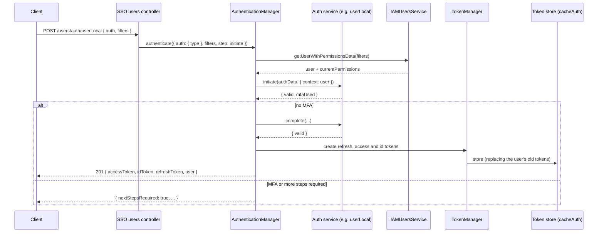
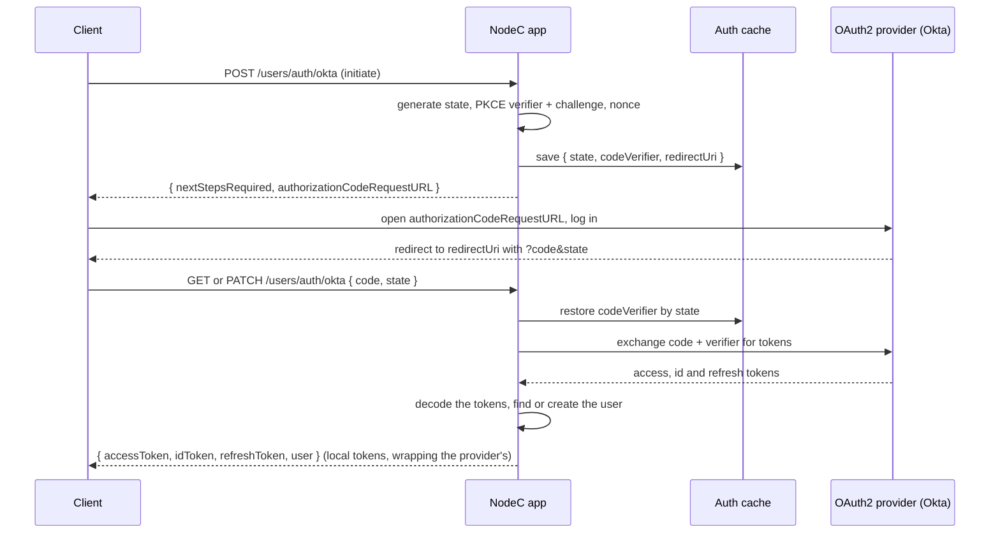
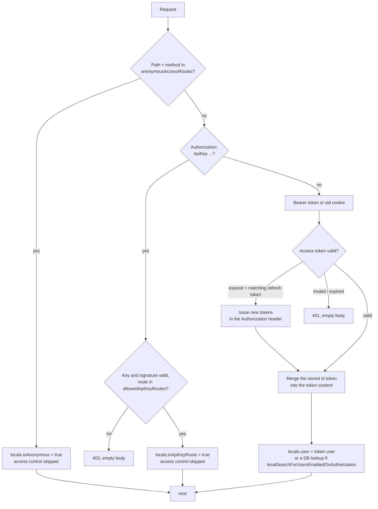

# Authentication

Authentication answers "who is making this request?". NodeC ships the whole flow: logging in with a password, an OAuth2 provider such as Okta, or another NodeC app; issuing and renewing JWTs; and checking the token on every request. Apps whose routes are all public don't need any of it (see [HTTP API module](../Fundamentals/http-module.md#defining-an-api-module)).

Authentication lives in `@node-c/domain-iam` (logging in, issuing and verifying tokens) and `@node-c/api-http` (the authorization middleware that runs on every request). Authorization - what a logged-in user may do - is covered in [Access Control](./access-control.md).

## Building blocks

| Service | Package | Role |
|---|---|---|
| `IAMAuthenticationManagerService` | domain-iam | Runs a login: picks the auth service by type, runs its steps, finds the user and issues the tokens |
| `IAMAuthenticationUserLocalService` | domain-iam | Email + password (HMAC-hashed) login, with pluggable MFA |
| `IAMMFAService` | domain-iam | Base class for MFA services - no implementation ships with the framework yet |
| `IAMAuthenticationOAuth2Service` (and Okta in `domain-iam-okta`) | domain-iam | OAuth2 login with an external provider |
| `IAMAuthenticationPassthroughService` | domain-iam | Lets another NodeC app log users in through this one, as a provider |
| `*Consumer` services | domain-iam | The consumer side - log in through another NodeC app (federated setup) |
| `IAMTokenManagerService` | domain-iam | Signs, stores, verifies and renews the JWTs |
| `IAMUsersService` | domain-iam | Users domain service, with `getUserWithPermissionsData` |
| `IAMAuthorizationService` | domain-iam | `authorizeBearer`, `authorizeApiKey` and the static `checkAccess` |
| `HTTPAuthorizationMiddleware` | api-http | Authenticates every request |

In the reference app, these are extended in `apps/test/src/domain/iam/services` and wired into the API modules through the `API_MODULE_AUTHORIZATION_SERVICE`, `AUTHORIZATION_MIDDLEWARE_AUTHENTICATION_MANAGER_SERVICE` and `AUTHORIZATION_MIDDLEWARE_TOKEN_MANAGER_SERVICE` providers (see `apps/test/src/api/coursePlatformDelegated/coursePlatformDelegated.module.ts`).

## Logging in

The SSO app's users controller (`apps/test/src/api/sso/controllers/users/users.controller.ts`) exposes:

| Request | Step |
|---|---|
| `POST /users/auth/:authType` | initiate |
| `PATCH /users/auth/:authType` | complete |
| `GET /users/auth/:authType` | complete - for direct OAuth2 callbacks |
| `POST`/`PATCH /users/auth/passthrough` | passthrough (API key routes) |

`:authType` is the key of the auth service in the authentication manager, e.g. `userLocal` or `okta`. The login routes must be listed in the API module's `anonymousAccessRoutes`, otherwise the middleware rejects them with a 401.

Example - local login:

```http
POST http://localhost:2081/users/auth/userLocal
{ "auth": { "password": "AdminPassword" }, "filters": { "email": "admin@node-c.com" } }

201 { "accessToken": "...", "idToken": "...", "refreshToken": "...", "user": { ... } }
```



What `IAMAuthenticationManagerService.authenticate` does:
1. Picks the auth service for `auth.type`. An unknown type fails.
2. Runs the requested step (initiate by default). For `userLocal`, the user is found first by the `filters` (`findUserBeforeAuth`), then the password is HMAC-hashed with the configured algorithm and secret and compared with the stored hash.
3. If the step was initiate and no MFA was used, the complete step runs right away (unless the step config allows skipping it).
4. If the step returns external tokens (OAuth2), they're kept inside the local tokens.
5. Issues three local JWTs, all stored in the tokens data service, replacing the user's previous tokens of the same type:
   - **refresh token** - signed with `jwtRefreshSecret`, expires after `refreshTokenExpiryTimeInHours` (unless `rememberUser` is set)
   - **access token** - signed with `jwtAccessSecret`, expires after `accessTokenExpiryTimeInMinutes`. Its payload has the `userId` and the refresh token.
   - **id token** - its payload has the **user with permissions** (`getUserWithPermissionsData`, password removed)
6. If more steps are needed (e.g. MFA), it returns `{ nextStepsRequired: true, ... }` with the step's public fields instead.

Every failure returns the same `400 { error: 'Authentication failed.' }`. The real reason is only in the logs (`[Domain.<module>.AuthenticationManager]...`).

## Auth service step config

Each auth service has a default config for its two steps (`getUserAuthenticationConfig`), which `config.domain.<module>.authServiceSettings.<authType>.steps` can override. The authentication manager reads it to decide what to do around the auth service's own `initiate`/`complete`:

| Option | Step | Meaning |
|---|---|---|
| `findUser`, `findUserBeforeAuth` | both | Look the user up (by the request's `filters`), before or after the auth step |
| `findUserInAuthResultBy` | complete | Find the user by a field of the auth result, e.g. `{ userFieldName: 'email', resultFieldName: 'idTokenPayload.email' }` |
| `findUserInExternalTokenPayloads` | complete | Take the user from the external token payloads instead of the database |
| `createUser` | complete | Create the user from the external token payloads if they don't exist |
| `validWithoutUser` | both | Allow the step to succeed without a user |
| `authReturnsTokens`, `useReturnedTokens`, `useReturnedTokensAsLocal`, `decodeReturnedTokens` | complete | Handling of tokens returned by the auth service (keep them inside the local tokens, use them *as* the local tokens, decode them for user data) |
| `skipCompleteStepAllowedOnNoMFA` | initiate | Issue the tokens right after initiate when no MFA was used, without running complete |
| `stepResultPublicFields` | both | Fields of the step result returned to the client when more steps are needed (e.g. `authorizationCodeRequestURL`) |
| `cache.populate`, `cache.use`, `cache.settings` | both | Save step data (e.g. the PKCE verifier) in the auth cache, keyed by e.g. `state`, and restore it in the next step |

The step data is stored by the data service passed to the authentication manager as `dataUsersAuthCacheService` - `userStepDataItems` in the reference app's `cacheAuth` module.

## Other login methods

### OAuth2 and Okta

`IAMAuthenticationOAuth2Service` implements the authorization code flow with PKCE. `IAMAuthenticationOktaService` (`@node-c/domain-iam-okta`) extends it for Okta OIDC: it always uses PKCE and a nonce, finds the user by `idTokenPayload.email`, and creates them from the id token (`email`, `firstName`, `lastName`) if needed.



Config (`authServiceSettings.<authType>.oauth2`): `authorizationUrl`, `accessTokenGrantUrl`, `issuerUri`, `redirectUri`, `allowedIncomingRedirectUris` (if the client sends its own `redirectUri`), `codeChallengeMethod`, `defaultScope`, `accessTokenAudiences`, `verifyTokensLocally`, plus `clientId` and `clientSecret` from the environment. Refreshing the Okta access token isn't implemented yet.

### Federated login (consumer and provider)

A NodeC app can delegate logins to another NodeC app (the provider, e.g. the SSO app) with the `*Consumer` services:
- `IAMAuthenticationConsumerService` (and `IAMAuthenticationUserLocalConsumerService`, `IAMAuthenticationOAuth2ConsumerService`) forward the initiate/complete steps to the provider's endpoints with `httpRequest`, signed with an API key and secret.
- The provider returns its tokens; the consumer uses them **as its own local tokens** (`useReturnedTokensAsLocal`) and takes the user from the provider's id token.

Config (`authServiceSettings.<authType>.nodeC`): `baseUrl`, `initiateEndpoint`/`initiateEndpointMethod`, `completeEndpoint`/`completeEndpointMethod`, `refreshExternalAccessTokenEndpoint`/`...Method`, `apiSecretHashingAlgorithm`, plus `apiKey` and `apiSecret` from the environment.

### Passthrough (provider side)

`IAMAuthenticationPassthroughService` skips authentication: the caller (another NodeC app, authenticated with an API key on an `allowedApiKeyRoutes` route) has already authenticated the user, and the provider only finds the user and issues tokens - optionally wrapping external tokens passed in as `externalAccessToken`, `externalIdToken` and `externalRefreshToken`. `IAMAuthenticationPassthroughConsumerService` is the calling side.

### MFA

`IAMAuthenticationUserLocalService` takes a map of MFA services (`Record<IAMMFAType, IAMMFAService>`). When the request has `mfaType` and `mfaData`, the matching service's `initiate`/`complete` runs after the password check; a failed MFA check fails the login, and a used MFA makes the manager wait for the complete step. The framework only ships the `IAMMFAService` base class - you implement the actual MFA methods.

## Where tokens are stored

`IAMTokenManagerService` stores every issued token through a tokens domain service - in the reference app, a Redis entity in `cacheAuth` (`apps/test/src/data/cacheAuth/entities/tokens`) with the primary keys `userId` + `type` and `isArray: true`, so each user has one list per token type. Issuing a new token of a type replaces the user's previously stored ones (`purgeOldFromData`). This doesn't end older sessions, though: `checkAccessTokenExistenceLocally` only checks that the user has *a* stored access token, not that it's the one in the request, so an older token stays valid until it expires. The store entry's TTL is derived from the token expiry and `accessTokenExpiryStorageTTLMultiplier` / `refreshTokenExpiryStorageTTLMultiplier`.

## Authenticating requests



`HTTPAuthorizationMiddleware` runs on every route of every HTTP API module, **before routing**:
1. **Anonymous routes** - if the path and method match the module config's `anonymousAccessRoutes`, sets `req.locals.isAnonymous` and continues. Access control is skipped for these.
2. **API keys** - `Authorization: ApiKey <key> [<signature>]`. The key must equal the module's `apiKey`. If `apiSecret` and `apiSecretAlgorithm` are set, the signature must be the HMAC of the query string (GET), the JSON body or the path. The route must also be in `allowedApiKeyRoutes`, if any are configured. Sets `req.locals.isApiKeyRoute`, and access control is skipped.
3. **Bearer tokens** - `Authorization: Bearer <accessToken> [<refreshToken>]`, or the `sid` cookie.
   - The access token is verified. If `checkAccessTokenExistenceLocally` is set, it must also exist in the token store.
   - The user's stored **id token** is looked up by `userId` and merged into the token content - this is where `req.locals.user` comes from.
   - If the access token has expired and a matching refresh token was sent, new access, refresh and id tokens are issued and returned in the response's `Authorization: Bearer <access> <refresh>` header (and in the `sid` cookie, if a cookie was used).
   - If the token content has no user and `localSearchForUsersEnabledOnAuthorization` is set, the user is loaded with `getUserWithPermissionsData` on every request instead.

Failures end the request with 401 (403 for API keys) and an **empty body**. This includes requests to routes that don't exist, since the middleware runs before routing.

## Configuration

API module config (`config.api.<moduleName>`): `anonymousAccessRoutes`, `allowedApiKeyRoutes`, `apiKey`, `apiSecret`, `apiSecretAlgorithm`, `localSearchForUsersEnabledOnAuthorization`.

Domain module config (`config.domain.<moduleName>`): `accessTokenExpiryTimeInMinutes`, `refreshTokenExpiryTimeInHours`, `jwtAccessSecret`, `jwtRefreshSecret`, `checkAccessTokenExistenceLocally`, `defaultUserIdentifierField` and `authServiceSettings.<authType>` - e.g. `userLocal.secretKey: { secretKeyHMACAlgorithm, hashingSecret }`, plus optional `steps` overrides.

The reference app's values are in `apps/test/src/config/config.common.ts`. Secrets come from the environment.

> [!WARNING]
> `req.locals.user` comes from the id token issued at login, not from the database - changes to a user's roles, permissions or assigned resources only apply after they log in again.

> [!TIP]
> Every login failure returns the same `400 { error: 'Authentication failed.' }`, on purpose. The actual reason is in the logs, under `[Domain.<module>.AuthenticationManager]`.

---

Previous: [ClickHouse](../Data/clickhouse.md) · Next: [Access Control](./access-control.md)
