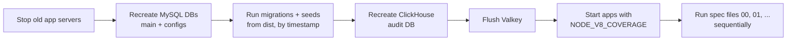

# End-to-end Tests

The e2e suite runs real HTTP requests against the reference app (`apps/test`) with all of its storages: MySQL (main and configs databases), ClickHouse (audit) and Valkey (cache and auth cache).

## Running

```bash
# build the packages and apps/test first - the apps, migrations and seeds all run from dist
npm run test
npm run test:report-coverage # text + HTML report in coverage/report
```

The config is [test/vitest.config.ts](https://github.com/RazorDude/node-c/blob/master/test/vitest.config.ts) and the setup is [test/vitest.globalSetup.ts](https://github.com/RazorDude/node-c/blob/master/test/vitest.globalSetup.ts).

## What the global setup does



1. Stops any app/SSO servers still running from a previous run (by port).
2. Drops and recreates the main and configs MySQL databases, regenerates the datasource files (`DATASOURCE_ENV=endToEndTests`) and runs the migrations - **seeds run together with the migrations**, ordered by timestamp.
3. Drops and recreates the ClickHouse audit database and its `userLoginLogs` table.
4. Flushes both Valkey instances.
5. Deletes the old log file and starts the apps (`npm run start:apps-test:direct`) with `NODE_V8_COVERAGE=coverage/results-data`.

App logs go to `logs/app_logs_<NODE_ENV>.txt` - the first place to look when a request returns an unexpected 400/403/500.

## Layout

```
apps/test/test/e2e/
  00.general.e2e.spec.ts
  01.admin.loginAndSingleServiceFind.e2e.spec.ts
  02.admin.createAndMultiServiceFind.e2e.spec.ts
  03.admin.singleServiceFindOne.e2e.spec.ts
  04.admin.bulkCreate.e2e.spec.ts
  05.admin.multiServiceFindOne.e2e.spec.ts
  06.admin.update.e2e.spec.ts
  07.admin.delete.e2e.spec.ts
  08.user0.loginAndPermissions.e2e.spec.ts
  09.additionalUsers.noAccessChecks.e2e.spec.ts
  common/
    e2e.common.ts              - BASE_URL_COURSE_PLATFORM_DELEGATED, BASE_URL_SSO, loginUser, findUserByEmail, findAllUserLoginLogs
    e2e.common.definitions.ts  - TestCourse, TestUser, TestUserLoginLog
```

- Only files matching `[0-9][0-9].*.e2e.spec.ts` are included.
- Files run **sequentially in alphabetical order** (`fileParallelism: false` plus an alphabetical sequencer), and they share one database. Later files see the data created, updated and (soft-)deleted by earlier ones - e.g. course 1 is soft-deleted in `07`, so `08` can't rely on it.
- New files get the next number. A file that needs fresh data should create it itself, or the data should be added as a seed.

## Seeded users and roles

| Id | Email | Password | Role | Assigned courses | Notes |
|---|---|---|---|---|---|
| 1 | admin@node-c.com | AdminPassword | 1 (Admin) | - | full access |
| 2 | user0@node-c.com | User0Password | 2 (User) | 1, 4 | |
| 3 | user1@node-c.com | User1Password | 2 (User) | none | `isVerified = 0` |
| 4 | user2@node-c.com | User2Password | 2 (User) | 1 | account status "Suspended" (`userLoginAllowed = 0`) |
| 5 | user3@node-c.com | User3Password | 3 | 1, 2, 3, 4 | only has a permission for `otherModule` |

The framework's login flow doesn't check `isVerified` or `userLoginAllowed` - both users can log in unless the app adds that check.

The initial data seed creates users 2-5 with role 2. The `AdditionalUsersNoAccessChecks` seed then moves user 3 (id 5) to role 3, removes user 1's (id 3) courses and assigns course 4 to user 0 (id 2).

The permissions are in the seeds in `apps/test/src/data/db/seeds/common` - see [Access Control](../Security/access-control.md) for how they're evaluated.

## Writing tests

- Use the helpers from `common/e2e.common.ts` (`loginUser`, `findUserByEmail`, ...) instead of repeating the requests.
- When a test depends on data changed by earlier files, compare against the admin's result for the same query instead of hardcoding the expected values.
- Don't put `expect` inside conditionals - check the individual properties of the affected items.
- Put shared types in `common/e2e.common.definitions.ts`.

> [!TIP]
> The suite is a good map of what the framework does: filters, relations, multi-service reads, permissions and local logins all have tests in the numbered spec files. OAuth2/Okta logins and the token refresh flow aren't covered yet.

---

Previous: [Federated login](../Recipes/federated-login.md) · Next: [FAQ](../faq.md)
