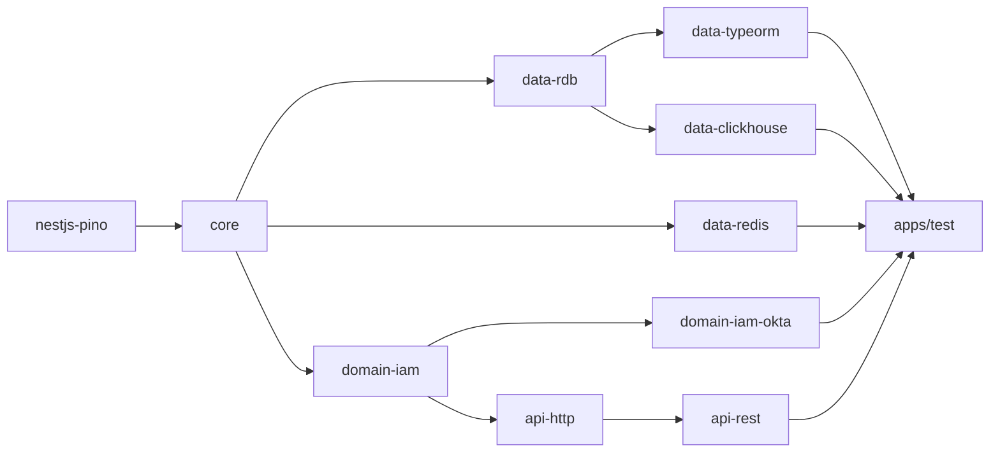

# Contributing

How to build, check and test the NodeC monorepo. Contributions to the framework itself are made and reviewed by people - the AI guides in these docs are meant for building apps _on_ the framework.

## Requirements

- Node.js 22 or later, npm 12 or later
- For the e2e tests and the reference app: MySQL (3306), ClickHouse (8123) and two Redis/Valkey instances (6379 and 6380)
- Env files in `apps/test/envFiles/.<env>.env` (gitignored - see [Configuration](./Fundamentals/configuration.md) for the variable format)

## Repository layout

An npm workspace with `packages/*` (the published `@node-c/*` packages) and `apps/*` (the reference app, `@node-c/app-test`). Packages depend on each other through the workspace, so a package always uses the **built** `dist` of its dependencies.



## Building

```bash
npm install
npm run build:clean:all   # every package and apps/test.
```

Per package (`npm run <script> --workspace=packages/<name>`):

| Script                              | What it does                                                           |
| ----------------------------------- | ---------------------------------------------------------------------- |
| `build` / `build:clean`             | Compile with `tsc -p tsconfig.build.json` (clean: delete `dist` first) |
| `build:watch` / `build:watch:clean` | Compile in watch mode                                                  |
| `check-types`                       | Type check without emitting                                            |
| `lint` / `lint:fix`                 | Biome checks                                                           |
| `format` / `format:check`           | Biome formatting                                                       |
| `publish-package`                   | Clean build and publish to npm                                         |

Root scripts: `lint:all`, `lint:all:parallel`, `lint:fix:all:parallel`, `publish-package:all`, `clean-dependencies`.

After changing a package, rebuild it **and everything that depends on it** before running the app or the tests - they load the compiled code.

## Code conventions

- ESM everywhere (`"type": "module"`); relative imports end in `.js`.
- TypeScript 7. No `any`.
- Types and interfaces go in a `<name>.definitions.ts` file next to the code that uses them.
- No barrel `index.ts` files. Folders that are imported as a whole (`import * as FolderData`) have a named index file (`db.entities.ts`, `coursePlatformDelegated.services.ts`) - see [loadDynamicModules](./Fundamentals/core-utilities.md).
- Biome is the linter and formatter - run `lint` before submitting.

## Testing

```bash
npm run test                  # e2e suite: recreates the databases, starts the apps from dist, runs the specs
npm run test:report-coverage  # coverage report in coverage/report
```

See [End-to-end tests](./Testing/e2e.md).

## Running the reference app

```bash
npm run build:clean:all
NODE_ENV=local npm run start:dev --workspace=apps/test   # node --watch dist/main.js
```

With the `local` profile (`apps/test/src/config/profiles/config.profile.local.ts`), the APIs listen on 2070 (course platform, delegated), 2060 (federated), 2050 (standalone) and 2080 (SSO). The e2e profile uses the same ports plus one.

The smaller `apps/first-steps` app is the one built in the [First steps](./first-steps.md) tutorial - it needs no external services.

## Docs

The docs are Markdown files in `docs/`, readable on GitHub, and a [VitePress](https://vitepress.dev) site with a sidebar, search and Mermaid diagrams:

```bash
npm run docs:dev      # local site with hot reload
npm run docs:build    # static build into docs/.vitepress/dist - fails on dead links
npm run docs:preview  # serve the build
```

- The sidebar is defined in `docs/.vitepress/config.mts` - add new pages there, and update the `Previous` / `Next` links at the bottom of the neighbouring pages.
- Use relative Markdown links (`[Controllers](../Overview/controllers.md)`) - they work both on GitHub and in the site.
- Callouts use the GitHub alert syntax (`> [!TIP]`, `> [!WARNING]`), which both render.

## Releasing

Releasing is done by the main contributors, after your code is merged.

---

Previous: [Migration guide](./migration-guide.md)
